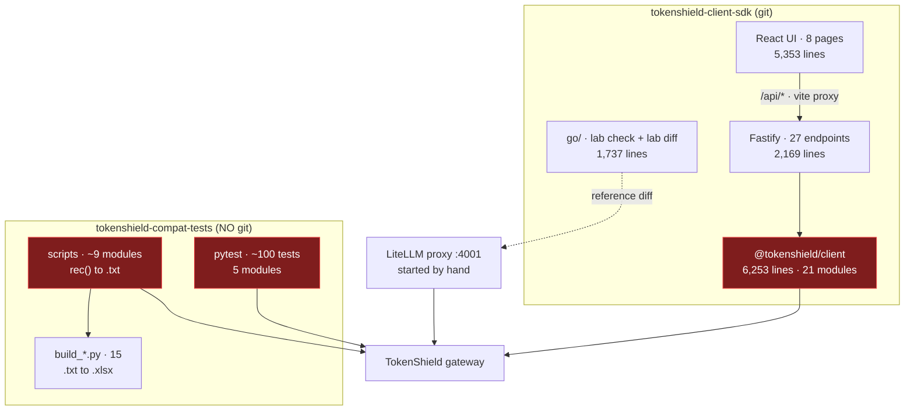
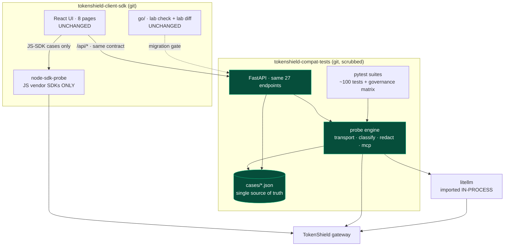
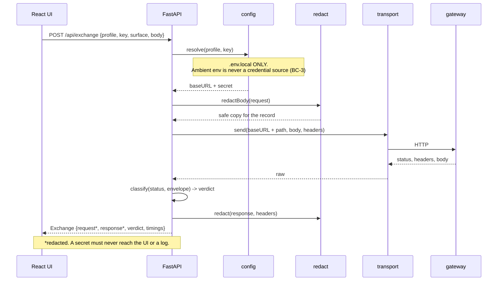
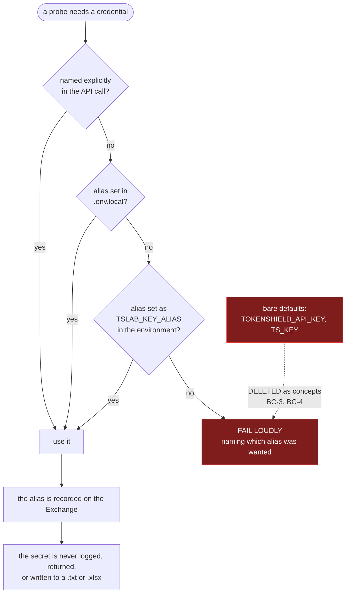
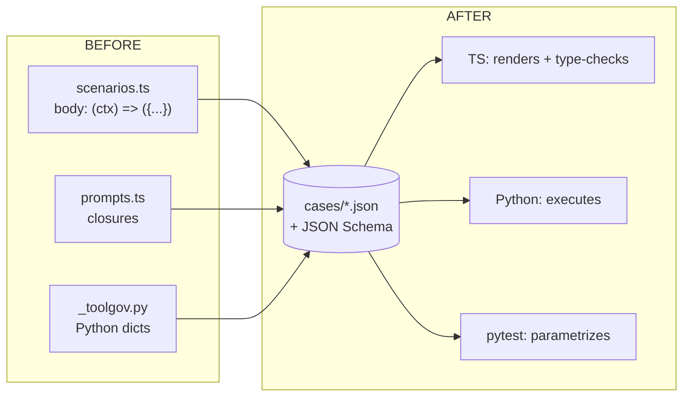
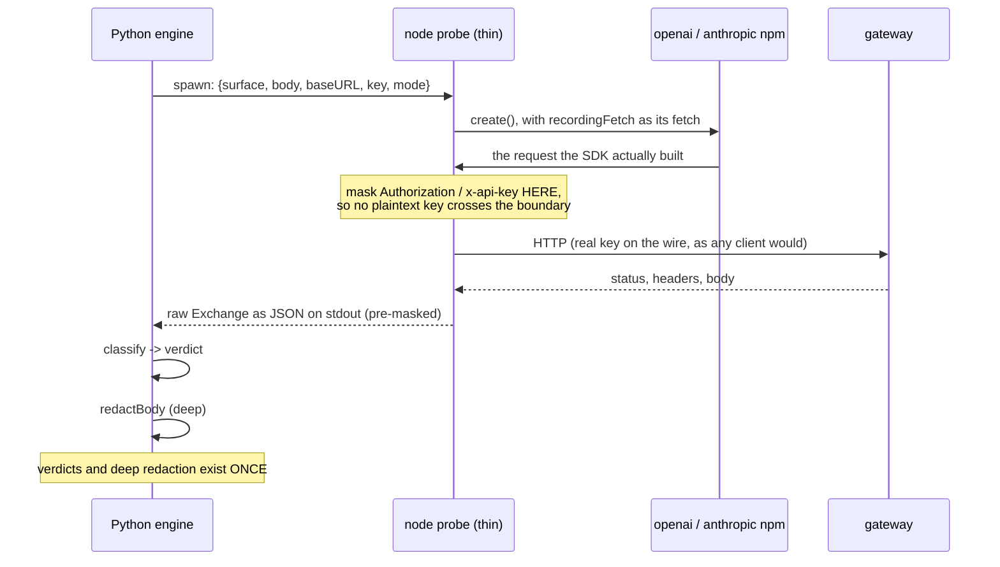

# Convergence — Python probing + TS UI

**Status:** **Phases 0–7 complete**; **8.1 done — the Node backend is retired** (2026-09-08). **Every endpoint is on the Python
engine except `/api/compare`**, which D-6 keeps in Node permanently. `lab diff` runs
62 cases, all clean, plus **three** parity scripts — the SSE parser on a recorded byte
fixture, all 16 scenario bodies, and `fields.ts` against LiteLLM in-process. 139
engine+reference tests, 306 collected across the compat suite. 0.2 withdrawn (D-9);
every phase re-scoped after testing its premise, twice a documented deferral was
caught by the gate at the moment it came due, and in Phase 7 two of three steps
dissolved on inspection.
**Next: Phase 8.2 — delete the now-dead `packages/client` modules; then 8.3, one README.**
**Decisions:** all closed as of 2026-09-07 (§10).
**Governs two repos:** `tokenshield-client-sdk` (this one) and
`tokenshield-compat-tests`.
**Maintained during execution.** Every phase updates §10 Decision log and §11
Change log. A phase is not done until this file reflects it.

---

## 1. Why

Two independent efforts probe the same gateway today. Neither knows about the
other, and they have already re-derived each other's work — the MCP manual test
cases written in this repo duplicate `TOOL_GOVERNANCE_TEST_PLAN.md` Groups A–D
almost case for case.

The target is one probing engine in Python, one UI in TypeScript, one findings
ledger. Python is chosen because it is where the customer reality is: the
`openai` Python SDK is the reference client, and **LiteLLM is itself a Python
library**, so the reference comparison becomes an in-process import instead of a
proxy on `:4001` with provider credentials that have to be guessed at.

### What makes this different from the abandoned Go migration (AD-32)

The shape is identical — rewrite a working layer in another language — so the
distinction has to be explicit or the mistake repeats.

| | Go migration | This |
|---|---|---|
| New capability | none | reference SDK, LiteLLM in-process, distributable pytest suite |
| Layer count | 1 → 2 (added a duplicate) | 2 → 1 (absorbs an existing duplicate) |
| Customer-visible change | none in ~6 sessions | a suite a customer can run against their own key |
| Duplication policing | 1,100 lines of golden files | temporary, and gated by `lab diff` |

**The second row is the whole argument.** It only holds if we converge *and
retire*. Adding a Python backend while keeping both existing probing layers
produces three, which is worse than today. §9 carries the tripwire.

---

## 2. Ground truth — what actually exists

Measured 2026-09-07, not recalled.

### 2.1 `tokenshield-client-sdk` (this repo)

| Part | Lines | Contents |
|---|---|---|
| `packages/client` | 6,253 | 21 modules — transport, classify, scenarios, prompts, mcp, fields, probes, surfaces, tools, governance, preflight, redact, stream, sse, adapters, management, signal, curl, types, index |
| `packages/server` | 2,169 | Fastify, **27 endpoints**, 127.0.0.1 only |
| `packages/web` | 5,353 | React 19 + Vite 6 + Tailwind 4, **8 pages** |
| `go` | 1,737 | `lab check` (gateway source-drift), `lab diff` (two-gateway differ) |

Verified working 2026-09-07: all 8 pages render, no console errors, all six
preflight checks pass against Prod US. 19 findings recorded in `FINDINGS.md`.

Only ~1,000 of the 6,253 client lines are baseURL calling (`transport` 616,
`client` 211, `sse` 124, `signal` 67). The rest is domain logic.

### 2.2 `tokenshield-compat-tests`

10,860 lines of Python. **Not a git repository.** `requirements.txt` declares
`openai>=1.40`, `pytest>=8.0`, `requests>=2.31`, `pymongo>=4.6`.

Three distinct kinds of thing live here:

| Kind | Modules | Detail |
|---|---|---|
| **pytest suites** | 5 | ~100 test functions: `test_chat_completions.py` (33, 9 xfail), `test_keys.py` (25, 10 spend), `test_tool_calling.py` (21, 4 xfail), `responses_sdk_test.py` (13), `responses_toolgov_test.py` (8) |
| **standalone scripts** | ~9 | `main()` + `rec(cid, title, verdict, detail)` → `.txt`. `chat_params_test.py`, `responses_test.py`, `sr_test.py`, `management_keys_test.py`, `test_tool_breaking.py`, others. **Not collected by pytest despite the name.** |
| **report builders** | 15 | `build_*.py` read the `.txt` and emit `.xlsx` |

Plus design docs that are ahead of anything in this repo:
`TOOL_GOVERNANCE_TEST_PLAN.md` (12-key matrix, Groups A–D),
`TOOL_GOVERNANCE_REGRESSION_DESIGN.md`, `MANAGEMENT_API_SPEC.md`,
`RUNBOOK.md`, `colgate-poc/TEST_MATRIX.md`.

### 2.3 Coverage overlap

| Surface | TS lab | Python |
|---|---|---|
| `/v1/chat/completions` | yes | yes (3 modules) |
| `/v1/responses` | yes | yes (3 modules) |
| MCP servers / tools / policy | yes + **UI + wire-name derivation** | yes + **12-key governance matrix** |
| `/v1/models` | yes (preflight) | **no suite** |
| `/v1/moderations` | yes (LANDMINE-1) | **no suite** |
| `/v1/embeddings` | no | yes |
| `/v1/files` | no | yes |
| Smart routing | no | yes |
| Management API | partial (mint) | yes + spec + Mongo seeding |
| Streaming analysis (gaps, timings) | **yes, unique** | partial |
| LiteLLM reference diff | **yes, unique** | no |
| `/v1/messages` (Claude Code) | no | no — manual plan only |
| `/v1/completions`, `/v1/batches`, token counting | no | no |

Neither side is a superset. Both have unique value.

### 2.4 Things Python already does better

Recorded because each is a gap in this repo that convergence closes for free:

- **`strict=True` xfail.** A landmine that gets fixed becomes XPASS and *fails
  the build*. This repo hit exactly the opposite failure on 2026-09-06: a
  status-only expectation would have gone green while the defect persisted.
- **Custom request headers.** `headers(api_key, extra=...)` already supports
  `x-mcp-servers`, which is the entire test group this repo lists as blocked.
- **Spend gating** via `TS_ALLOW_SPEND=1` and a `spend` marker, rather than
  ad-hoc judgement per run.
- **Mongo key seeding** (`seed_key.py`) using the gateway's own SHA-256 hashing,
  so scoped fixture keys exist without the Java control plane.
- **Shared vocabulary already.** LANDMINE-3 means the same thing in both repos,
  and the Python side cites gateway source (`provider.go:67`).

### 2.5 Blocking problems found during the check

| ID | Problem | Severity |
|---|---|---|
| **BC-1** | **23 distinct credentials, not 8.** *Corrected 2026-09-07 during Phase 0.1 — the original figure came from a grep scoped to `.py`/`.txt`/`.csv` only, and a tree-wide scan found nearly three times as many.* Actual spread: **15 in `RUNBOOK.md`** (a committed doc), 10 across five `env.*` scripts (the intended credential store), 2 `cg-mk-` **management keys** in `build_management_keys_xlsx.py`, one shared production key duplicated across 6 modules as `DEV_KEY`, and one inside a generated `.xlsx`. | **critical** |
| **BC-2** | That repo has **no git**. `git init` before scrubbing bakes BC-1 into history permanently. | **critical, sequencing** |
| **BC-3** | Credential policy conflict. Python reads `os.environ` for keys. This repo reads `.env.local` and **deliberately never** the ambient environment. Both cannot be right. | high |
| **BC-4** | `TS_KEY` silently **shadows** `TOKENSHIELD_API_KEY` in `chat_params_test.py`. Documented in RUNBOOK §5; already cost 2 hours of 403 debugging once. | high |
| **BC-5** | Base URL convention conflict. Python `TOKENSHIELD_BASE_URL` **includes** `/v1`; this repo's profiles exclude it. | medium |
| **BC-6** | `pymongo` gives the Python side direct Mongo access. The standing constraint is that the SDK stores nothing in a database. Reading and seeding fixtures is not storing, but the boundary must be written down. | medium |
| **BC-7** | Two default model matrices: Python defaults to GLM, this repo to `bedrock-claude-haiku-4.5`. | low |
| **BC-8** | `TOOL_OUT` / `CHAT_OUT` are **truncated every run**, so a run silently destroys the previous evidence. | low |

---

## 3. Current architecture (HLD)

Red boxes all probe the same gateway. That is the duplication.

---

## 4. Target architecture (HLD)

Three things to notice:

1. **The UI's contract does not change.** Same 27 endpoints, same shapes. The UI
   is not part of this migration.
2. **Node keeps exactly one job** — running the JS vendor SDKs (`openai`,
   `@anthropic-ai/sdk`). That is coverage, not duplication: customers use both
   the JS and Python SDKs, so both are real signals.
3. **LiteLLM is imported, not proxied.** No `:4001`, no provider-credential
   ambiguity of the kind that made two cases uncomparable on 2026-09-06.

---

## 5. Component ownership — moves, stays, dies

| Component | Lines | Fate | Why |
|---|---|---|---|
| `transport.ts` | 616 | **moves** | the baseURL layer; Python has it partly in `_util.py`. Not kept for the probe — see D-7 |
| `sse.ts` | 124 | **moves** | Python `parse_responses_sse` already exists |
| `classify.ts` | 193 | **moves** | verdict logic belongs with the engine |
| `redact.ts` | 195 | **moves — Python owns it outright** | see D-7: the probe emits pre-masked records, so deep redaction exists once |
| `mcp.ts` | 766 | **moves**, merge with `_toolgov.py` | biggest single merge; wire-name derivation is unique to this repo and must survive |
| `scenarios.ts` | 646 | **becomes data** (Phase 1) | closures cannot cross languages |
| `prompts.ts` | 692 | **becomes data** (Phase 1) | same |
| `fields.ts` | 272 | **becomes data** | already a table transcribed from LiteLLM source |
| `probes.ts`, `surfaces.ts`, `governance.ts`, `preflight.ts`, `tools.ts`, `management.ts`, `signal.ts`, `stream.ts` | 1,796 | **moves** | engine logic |
| `adapters.ts` | 312 | **stays in Node** | imports the real `openai` / `@anthropic-ai/sdk` npm packages. No Python path to the JS SDKs. |
| *(new)* `probe.ts` | ~150 | **new, replaces transport for the probe** | D-7: HTTP + header masking + raw JSON on stdout. Python classifies and redacts. |
| `types.ts` | 244 | **splits** | wire types generated from a shared schema; UI view types stay TS |
| `curl.ts` | 43 | **moves** | trivial |
| `packages/web` | 5,353 | **stays, untouched** | |
| `go/` | 1,737 | **stays, untouched** | `lab diff` is the migration gate |
| Python `build_*.py` (15) | — | **stays**, later fed by the engine | xlsx reporting is a real deliverable |
| Python scripts (~9) | — | **converge** into the engine + pytest | they duplicate what `/api/scenarios/run` does |

---

## 6. LLD — request path

What one probe looks like after convergence. The `Exchange` record is the
contract between engine and UI and must survive the move byte-compatible, or the
UI's exchange log breaks.

## 6.1 LLD — credential resolution (resolves BC-3, BC-4)

The single most dangerous divergence between the two repos. This is the rule the
merged engine must implement.

**Resolved: D-2 option C — the alias-slot model.** The danger was never the
environment; it was the *unnamed default*. `TOKENSHIELD_API_KEY` is a default:
picked up implicitly, unattributable, single-valued, and the only reason `TS_KEY`
can shadow anything at all. Shadowing is possible only between two variables that
both mean "the default key". `TS_KEY_MCP_SELECTED` is a named slot and has none of
those properties — and the governance matrix already works that way.

A flag was the wrong control. A flag everyone sets is not a control, and in CI it
would be permanently on.

Why this satisfies both consumption models:

| Property | Needed by | Satisfied because |
|---|---|---|
| attributable — a finding names its key | this repo | the alias is on the `Exchange`, not "whatever was exported" |
| many keys at once | this repo, and the 12-key matrix | one slot per alias, in either source |
| no silent prod run | both | there is no bare default to pick up |
| `pytest` idiom | Python suite | `TSLAB_KEY_FOO=... pytest` still works |
| CI secret injection | Python suite | CI sets slots as environment variables |
| the matrix keeps its shape | Python suite | it was already one variable per key |

**Rule:** no bare default at any level. An unnamed key request errors rather than
guessing. `TOKENSHIELD_API_KEY` and `TS_KEY` are deleted, which fixes BC-4
structurally rather than removing one variable and leaving the pattern in place.

## 6.2 LLD — cases as data (Phase 1)

Bodies become JSON with a small template vocabulary (`{{model}}`,
`{{embedModel}}`) instead of arbitrary closures. Anything that genuinely needs
code becomes a named generator both sides implement — kept to as few as
possible, and every one listed in §11 when added.

## 6.3 LLD — the JS-SDK probe boundary (D-7)

Tracing what `adapters.ts` actually needs changed this design. `recordingFetch`
is handed to the SDK's constructor and delegates to `Transport.sendRaw`, so
keeping the probe on the existing stack drags in **1,439 lines** — transport,
classify, redact, signal, sse, types — every one of which Python would also own.
Parallel implementations policed by golden files is precisely the Go mistake, and
1,400 lines of exactly that were deleted on 2026-09-07 (AD-32).

So the boundary moves instead: the probe does HTTP and nothing else.

What the probe keeps: `adapters.ts` (312) plus a new `probe.ts` (~150) plus the
wire types. What it does **not** keep: classify, redact, signal, sse, transport.
Duplication is a ~20-line header mask, not 1,439 lines of parallel logic.

The header mask is the one thing that exists on both sides, and it is tiny,
single-purpose, and covered by the same test vectors as the Python masker.

**Residual risk:** the raw record crosses a pipe. It is pre-masked, same machine,
same trust boundary as the process holding the key anyway — but it is a new path
and Phase 2 must include a test asserting no `cg-ak-` / `cg-mk-` value can appear
on that boundary.

---

## 7. Conventions to reconcile before any code moves

| # | Conflict | Resolution |
|---|---|---|
| 1 | baseURL includes `/v1` (Python) vs excludes it (TS) — BC-5 | **excludes.** Profiles name a gateway, not a surface; `/v1/...` is part of the path. Python's `BASE_URL` gets a one-line shim. |
| 2 | Credential source — BC-3, BC-4 | **resolved, D-2 option C**: alias slots in either `.env.local` or the environment, no bare default, `TOKENSHIELD_API_KEY` and `TS_KEY` deleted. §6.1 |
| 3 | Default model matrix — BC-7 | one default per repo is fine; the **case files** must never hardcode a model. `{{model}}` only. |
| 4 | Findings numbering | one ledger: `FINDINGS.md` here. Python landmine numbers are authoritative where they exist (LANDMINE-1/2/3), since they cite gateway source. |
| 5 | Result artefacts truncated per run — BC-8 | timestamped output directory; never truncate. |
| 6 | Mongo access — BC-6 | allowed for **reading** org/key config and **seeding fixture keys** only. The lab still persists no state of its own. Written into the engine's module docstring. |
| 7 | Redaction ownership | **resolved, D-7**: Python owns deep redaction; the Node probe masks auth headers before emitting. One deep implementation, one ~20-line mask. §6.3 |

---

## 8. Phases

Each phase has an exit gate. A phase is not done until its gate passes **and**
§10/§11 of this file are updated.

### Phase 0 — Safety and ground truth *(no migration work)*

Ordered. 0.1 must precede 0.3.

| Step | Action | Gate |
|---|---|---|
| 0.1 | ~~Scrub the 8 real credentials from 12 files~~ Scrub every credential from files that will be committed (BC-1, corrected to 23). Source reads named env slots via a new `_creds.py`; `RUNBOOK.md` keeps a name-only inventory; the `env.*` credential store is gitignored rather than scrubbed, because it is the store. | **restated:** no credential in any file **git would track**. A tree-wide grep returning nothing was the wrong gate — the `env.*` scripts legitimately hold keys and `env.toolgov.sh` says so in its own header; destroying them would break a working setup. | **DONE 2026-09-07** |
| 0.2 | **User action, narrowed to 3 keys** (see D-8 for why the other 20 are an accepted risk): the **2 `cg-mk-` management keys** from `build_management_keys_xlsx.py`, and **`Bedrock Test`** — the `cg-ak-` key its own source comment called a prod key, duplicated as `DEV_KEY` across six modules. **Order matters:** mint replacements *first*, revoke the old management keys *last*, or you lose the minting path. | **WITHDRAWN — this should not have been a step.** See D-9. |
| 0.3 | `git init` + first commit. *(`.gitignore` moved into 0.1 — the 0.1 gate depends on it.)* Added `.gitattributes` (`eol=lf`): without it every file reported a CRLF conversion on a Windows checkout, and that churn hides real diffs in a repo whose whole value is reviewable evidence. | **DONE 2026-09-07** — `fea3c7c`, 59 tracked / 64 ignored, history verified clean |
| 0.4 | Merge the two findings ledgers into `FINDINGS.md`; dedupe; mark every entry with source and confidence | **DONE 2026-09-07** — one ledger, 26 entries (17 `F-*`, 9 `LM-*`). Gained 6 findings this repo did not have; 3 confirmed independently on both sides. Ids **not** renumbered (`LM-*` from Python, `F-*` from here) because both repos reference them. **One contradiction left open on purpose** — see below. |
| 0.5 | Write §7 conventions into both repos as code comments, not just here | **DONE 2026-09-07** — 5 comments placed next to the lines they govern: baseURL/`GATEWAY_ROOT` and the truncation warning in `_util.py`, the Mongo boundary in `seed_key.py`, the one-ledger rule in the Python `README.md`, and the shared credential rule in `config.ts`. A convention living only in a design doc is one nobody reads at the moment they are about to break it. |

**Deliverable a person can see:** one findings list, and a version-controlled
Python repo with no secrets in it. **Both delivered.**

#### Phase 0 outcome

**Complete** — four real steps. 0.2 was withdrawn as a step that should not have existed (D-9).

| | |
|---|---|
| Credentials in tracked files | **0** — was 23 across 12 files |
| Python repo | version-controlled, history verified clean, 59 tracked / 64 ignored |
| Findings | **one** ledger of 26 — 17 from here, 9 from the Python suite — replacing two separate lists |
| Conventions | 5, placed in code rather than only in this document |
| Regression check | 167 pytest tests collect; 40 Python files compile; TS typecheck, tests and eslint clean |

**What the merge actually bought.** Six findings this repo did not have, the
sharpest being **LM-2**: `messages[].content` as an array is refused even when
text-only. That is the broadest client-compatibility break on the list — it
rejects valid OpenAI requests from clients that never asked for images — and it
had been sitting in the Python suite as a `strict=True` xfail the whole time.
Three findings were reached independently on both sides, which is the strongest
confidence signal available without re-measuring.

**One contradiction is recorded and deliberately unresolved.** LM-1 (Python,
citing `handler.go`) says the 400 body is flat; a 2026-09-06 measurement here
found 400 and 404 bodies properly OpenAI-shaped and only `/v1/moderations` flat.
Either the gateway was partly fixed or the two lists describe different handlers.
Guessing which would put a false fact into a document whose value is that it
contains none.

#### Exposure assessment (measured 2026-09-07, after 0.1)

Written down because the first framing of 0.2 — "rotate all of them" — was not
proportionate, and the reasoning for narrowing it should outlive the decision.

| Question | Answer |
|---|---|
| Cloud-synced? | **No.** OneDrive exists at `C:\Users\shiva\OneDrive`; the repo is a sibling of it, not inside it. Nothing left the machine. |
| Ever committed or pushed? | **No.** There was no git, which is BC-2 — and the reason BC-2 was rated critical. |
| Who could read the plaintext? | the machine's own user, anything running as them in that directory, and local backups if any exist |
| What was the real risk? | **prospective, not realised**: one `git init && git push` from publishing 23 working keys. Phase 0.1 closed exactly that. |

So the exposure was local disk on a single-user, unsynced machine. That justifies
rotating the keys whose blast radius is large, and not the scoped test keys.

#### How rotation works on this gateway

Creation is in the Management API; revocation is not, and is control-plane only.
Both facts come from the compat suite's own docs and test plans.

| Action | Mechanism | Source |
|---|---|---|
| Mint an API key | `POST {base}/api/v1/management/api-keys` with `x-management-key` | `MANAGEMENT_API_SPEC.md` §4 |
| Revoke an API key | admin console: ban icon → type `REVOKE` → confirm | test case A9, `build_test_plan_xlsx.py` |
| Revoke a management key | GraphQL `revokeAiGatewayManagementKey(managementKeyId:)`, org-guarded | test case B5, same file |

### Phase 1 — Cases as data

**Re-scoped 2026-09-07 before starting, and it shrank to one change.** The
premise was "TS closures cannot cross languages, so extract them to a neutral
format". Checking that premise showed case definitions are read **server-side
only** — with one exception: `PromptLab` fetched `/api/prompts/cases` while
`Scenarios.tsx` imported `SUITES` straight from the client package. That
inconsistency was the entire obstacle. Once both pages fetch, definitions live
behind the API and move to Python in Phase 3 as Python literals, which is how
the Python suite already writes its own cases. No neutral format, no schema, no
dual readers — those would have been three artefacts serving a requirement that
does not exist.

| Step | Action | Gate |
|---|---|---|
| 1.1 | ~~Design `cases/*.json` + JSON Schema~~ **dropped** — nothing needs a language-neutral format; only the server reads cases | n/a |
| 1.2 | Make `Scenarios.tsx` fetch `/api/scenarios/suites` instead of importing `SUITES`, matching `PromptLab`. New `ScenarioSuiteInfo` in `api.ts` — deliberately **not** the client package's `Scenario` type, which carries a `body` closure and an `expect` that are the engine's business and do not survive JSON | **DONE 2026-09-07** — 0 type errors, 26 test files pass, eslint clean; UI verified live: 4 suites with 6/4/4/2 scenarios, descriptions and spend counts computed from fetched data, switching suites works |
| 1.3 | ~~Python reads the same files~~ **dropped** with 1.1 | n/a |

**Measurable side effect:** the web bundle fell from 338.29 kB to 330.65 kB. The
case definitions are no longer shipped to the browser, which they never should
have been.

**Gate met.** `lab diff` was not needed: the endpoint was not touched, only the
consumer, so the payload is identical by construction. Verified in the browser
instead, which is the stronger check for a UI change.

### Phase 2 — Python engine skeleton

| Step | Action | Gate |
|---|---|---|
| 2.1 | FastAPI on port 8801; `config` (§6.1 alias slots) and `mask` (the only deep impl). ~~`transport`, `Exchange`~~ **deferred to Phase 4** — neither migrated endpoint touches a gateway, so porting them here would build ahead of the requirement. The probe-boundary test moves with them. | **DONE 2026-09-07** — 20 tests. The one that matters serialises the whole public view and asserts no part of a credential appears in it, searched rather than field-by-field so a leak in a warning string is caught too. |
| 2.2 | `/api/health`, `/api/config` only | **DONE 2026-09-07** — `lab diff` reports **2 same, 0 differ**, first run. Cases in `testdata/migration-cases.json`; `uptimeSeconds` declared volatile, since the two backends started minutes apart. |

**Found by hand, not by the gate.** Content-type differed — Fastify sends
`application/json; charset=utf-8`, Starlette sends `application/json`.
Functionally identical for JSON, visibly different to a client. Matched in a
`LabJSON` subclass.

Worth recording as a limitation of the gate itself: **`lab diff` compares status
and body, not headers.** Not fixed by extending the differ — one field does not
justify a second volatility mechanism alongside the body one, since the only
header that *should* differ (`X-Lab-Impl`) would then need whitelisting. If a
later phase hits a header divergence, extend it then. Recorded in
`engine/README.md` so the next person does not rediscover it.

### Phase 3 — Data-serving endpoints  ·  **DONE 2026-09-07**

**Re-scoped before starting, and it fixed a contradiction rather than just
trimming.** The phase was written as seven "read-only" endpoints — but
`/api/preflight`, `/api/models` and `/api/mcp/browse` call the gateway, and
Phase 2 deferred `transport` to Phase 4. So Phase 3 as written depended on a
component scheduled *after* it. The honest split is by what an endpoint does,
not by whether it mutates: **Phase 3 serves data, Phase 4 calls gateways.** The
three movers go to Phase 4 with transport.

Migrated: `/api/scenarios/suites`, `/api/prompts/cases`, `GET`+`DELETE`
`/api/runs`, `/api/runs/{id}`. `DELETE` came along because leaving it 404 on
Python would break the UI at switchover.

**Gate met.** `lab diff` reports **9 same, 0 differ** — including `limit`
clamping, a junk `limit` falling back rather than 400ing, and the 404 path. Then
the UI ran end to end against the engine alone with Node stopped: Connect
renders its targets, Scenarios all four suites at 6/4/4/2 with the spend count
computed, Prompt lab renders. One line in `.env.local` switches it.

`engine/cases.py` is **generated** from Node's live payloads, not transcribed —
1,340 lines of TypeScript retyped by hand would differ in small ways the gate
would surface one at a time, whereas taking the served payload as the source
makes parity true by construction. Python literals rather than a JSON file:
that is how the Python repo already writes its own cases, and a literal can
carry a comment.

**The gate earned its keep on the first run.** The engine advertised
`mcpServerUrl` as its own port — but `/mock-mcp` is a Node endpoint that has not
migrated, so it was pointing clients at nothing. Now `TSLAB_MOCK_MCP_ORIGIN`,
defaulting to the Node backend, with a note to delete the setting when the mock
moves, so it stops being a lie at the same moment it stops being needed.

### Phase 4 — Anything that calls a gateway

**Split before starting.** The foundation is ~1,900 lines of TypeScript across
eight modules; doing all nine endpoints in one pass would have meant rushing the
part every other endpoint depends on.

#### 4a — the foundation, proved by one endpoint  ·  **DONE 2026-09-07**

`redact` (deep, the only implementation per D-7), `classify`, `signal`,
`surfaces`, `transport` (buffered path only) and the `Exchange` record, plus
**`/api/exchange`** — the one endpoint that exercises all of it, so a clean diff
on it means the foundation is right.

**Gate met:** `lab diff` **15 same, 0 differ** across everything migrated,
including a real free gateway call (`GET /v1/mcp/servers`) and the exchange
summary-row shape. 78 tests.

The classifier was read from source rather than written from memory — the Go
port of the same logic came out wrong in eleven places — and its ordering is now
commented as load-bearing.

**Three bugs, all caught rather than reasoned about:**

| bug | found by |
|---|---|
| `summarise_credential_exposure` lowercased header names then looked them up in the original dict, so `Authorization` — what every real client sends — returned nothing, and the summary reported "no credential kinds" for the commonest case | its own test |
| `mode` defaulted to `"buffered"`, which is not one of the three values. They are `raw`/`openai-sdk`/`anthropic-sdk` and describe who *built* the request, not whether it streamed | the gate |
| `store.summarize()` was a passthrough stub with a comment saying Phase 4 would fill it in. Returning whole Exchanges would have made the history endpoint send megabytes and broken the UI's log table | the gate, the moment the store first held anything |

**The third exposed a gap in the gate itself.** The run-list cases ran *before*
the exchange cases, so they compared empty stores and did not actually verify
the fix. A run-list case now runs **after** the exchanges — which is what had
caught it in the first place. A gate that only checks the empty state is not
checking the interesting one.

#### 4b — the remaining seven  ·  **DONE 2026-09-07**

`/api/models`, `/api/preflight`, `/api/mcp/browse`, `/api/mcp/test`,
`/api/mcp/call`, `/api/mcp/aggregate`, `/api/tools/loop`.

**Gate met:** `lab diff` **25 same, 0 differ** — up from 15 — including
preflight running all six checks live against Prod US, and the 53-model
catalogue (so JavaScript's `localeCompare` and Python's sort agree for these
ids, which was not a given).

**`/api/compare` is not migrated, and that is D-6 rather than a deferral.** It
drives the real `openai` and `@anthropic-ai/sdk` npm packages, and seeing what a
vendor SDK constructs is the entire point of that page. Node keeps it, and in
Phase 8 it becomes the thin probe of D-7. So 4b is seven endpoints, not eight.

**One endpoint the differ cannot gate honestly.** `/api/tools/loop` calls a
model, so its output is non-deterministic and a strict diff would be theatre. It
is gated on its three validation paths and then compared **structurally** on a
real round-trip — same surface, offered tools, turn count and kinds, statuses,
verdicts, tool called, local result. Both sides matched. Cost about 1.3 cents,
including the ~1,734 injected MCP tokens per call that F-4 describes.

**A false alarm worth recording.** A mid-run gate showed 6 differences that were
not code: the Python engine had been restarted to load `tools/loop` while Node
kept its accumulated history, so the run-list cases were comparing different
stores. Comparing stateful endpoints requires both backends to start from the
same state — now written into `engine/README.md`, because the failure looks
exactly like a real regression.

The §6.3 probe-boundary test belongs with the Node JS-SDK probe, which is Phase
8 — it does not exist yet. Its property is asserted today in the form that does
exist: no part of a credential appears anywhere in a serialised `Exchange`.

### Phase 5 — Streaming

**Split, as Phase 4 was.** The whole of it is ~2,000 lines: 483 of streaming
foundation plus the 1,338 of case bodies and expectations that Phase 1
deliberately left behind.

#### 5a — the mechanism  ·  **DONE 2026-09-07**

SSE parsing, `Transport.stream`, the relay, `/api/stream`,
`/api/governance/burst`.

**Two things the premise check changed:**

- **`stream.ts` (359 lines) is not needed.** Gap, anomaly and Responses
  lifecycle analysis is entirely *browser-side* — only `Streaming.tsx` imports
  it, and the server never analyses. It stays in TypeScript as UI code. **That
  also corrects the Phase 4a estimate** that Phase 8 would keep only the
  JS-SDK probe closure: the web imports 17 things from the client package,
  `analyseStream` and `checkResponsesLifecycle` among them, so whatever the UI
  imports survives too. To be *measured* in Phase 8 rather than guessed at a
  second time. **Measured 2026-09-08 — see §8.2.** The web's runtime closure is
  3,495 lines, which is exactly why the 5,700-line deletion estimate was wrong.
- **`/api/governance/burst` does not stream.** It loops and returns plain JSON,
  so "four streaming endpoints" was wrong — there are three. Burst came into 5a
  anyway, being simple and free.

**Gate met, and honestly.** A live streaming call is non-deterministic, so
gating on its output would be theatre. The parser is gated on a **recorded
fixture** pushed through both implementations with identical read boundaries —
which is what the gate above actually asked for. `npm run sse:parity`: **9
frames from 10 reads, byte-identical**. The fixture covers every branch that has
gone wrong somewhere, including the multi-byte character split across two reads
that bit the Go port. `lab diff` is **30 same, 0 differ**.

The live relay is then checked structurally, and matched: same event kinds,
contiguous seqs, a final `[DONE]`, same status and verdict, each side's
recording matching what it relayed. Frame count differed — 5 against 4 — which
is the provider splitting the same answer differently on two calls; both
assembled to the identical text. Worth checking rather than assuming, because a
coalescing bug in the reader would look the same from outside.

**Another deferred field came due, and the gate found it.** Phase 3 omitted
`label` and `docs` from the surface specs with a comment saying they would
arrive with the first endpoint that needed one. `/api/stream` refuses a
non-streamable surface *by label* — "MCP servers does not support streaming" —
and the engine was naming it by id. That is twice now that a documented
deferral has been caught by the gate at exactly the right moment.

#### 5b — the two runners  ·  **DONE 2026-09-07**

`/api/prompts/run` and `/api/scenarios/run`, plus the case **bodies** and
**expectations** — the 1,338 lines Phase 1 correctly declined to turn into a
neutral format. Phase 1 was right that no *neutral* format was needed; this is
where they arrive as Python, in the phase that actually reads them.

**Gate met:** `lab diff` **37 same, 0 differ**, and both parity scripts clean.

**Gating two runners without spending, two different ways:**

| | how |
|---|---|
| `/api/prompts/run` | has a `dryRun` mode that builds every body and returns it *without sending*. All **22 bodies gated through `lab diff` for free**, and byte-identical. |
| `/api/scenarios/run` | has no dry run, so `scripts/scenario-body-parity.mjs` is the free deterministic equivalent: build all **16 on both sides** with the same context and compare. |

Both sets of bodies are **generated**, not transcribed — the same reasoning as
`cases.py` in Phase 3. The scenario bodies are `(ctx) => ({...})` closures, so
they were invoked with sentinel context values and dumped; `resolve_body`
substitutes the real model by *walking the structure* rather than string-
replacing serialised JSON, so a sentinel inside an unrelated value cannot be hit
by accident. Verified safe before generating: `ctx.model` appears five times,
`ctx.embedModel` never, and neither is ever interpolated inside a longer string.
The parity script guards that assumption too — a future scenario that *does*
interpolate would fail there rather than months later at runtime.

**Verified live.** The `mcp` suite is 0-of-4 spending, so the scenario runner
was checked **for free** and matched exactly: same events, four identical
results, same tally (3 pass, 1 not-implemented), same targets. `mcp-session-id`
correctly reports `not-implemented` rather than a failure, so the inversion
works. The prompt runner was checked on the two cheapest cases — 4 calls per
backend, about 1.5¢ — and matched on estimate, outcomes, comparisons and
answers.

**113 tests.** The new ones cover the judgement calls rather than the happy
paths, because each is a place where a plausible implementation gives a wrong
answer that reads like a real result: a refusal case must be checked on status
*alone* or one defect reports several times over; a `withholdsTool` expectation
must not pass when no listing was emitted, or "blocked" gets reported for any
response that never listed anything; a 401 must make a landmine `inconclusive`
rather than `landmine-changed`, since the latter reads as "the bug may be fixed
here" when nothing was measured; and `bodyPath: true` means *present*, not
*equal to true*, so a field whose value is `false` still counts.

### Phase 6 — Stateful and management  ·  **DONE 2026-09-07**

`POST`/`DELETE` on `/api/targets/profiles` and `/api/targets/keys`,
`/api/keys/mint`, `/api/scenarios/export`, `/api/governance/probe-models`.

**Gate met:** `lab diff` **62 same, 0 differ** — up from 37, including a real
add / read-back / remove round trip for both session profiles and session keys.

**That completes every endpoint** except `/api/compare`, which D-6 keeps in Node
permanently.

**The registry is the substance, and its rule connects back to D-2.** An alias
may never be shadowed: adding a session key whose alias already exists is
*refused*, not silently preferred. That is the same failure D-2 removed from the
pytest side — a stale `TS_KEY` outranking `TOKENSHIELD_API_KEY` made a whole run
authenticate as the wrong key — and a friendlier form of it would be worse, not
better. Tested from both directions, plus that a rejected shadow leaves the
original still resolving.

Wiring it in **changed existing code** rather than only adding: `/api/config`
and `/api/health` now report the registry's view and `_resolve_target` consults
it. The gate covered that for free — those cases were already in the file and
stayed green.

`Transport.send` gained a **per-call secret override** for the one call that
presents a different credential from the transport's own: minting needs the
management key while the target still carries the api key. Per-call rather than
a second transport, so the exchange stays attributed to the same target.

**Minting is the only response in the tool containing a live credential.** The
exchange is redacted before it reaches the store — success path *and* failure
path — and the body is re-parsed from the scrubbed text so the structured copy
cannot disagree with the raw one. A mismatch there would leave the key visible
in the inspector while the text looked clean.

**The gate caught one real mistake immediately:** both add routes returned their
payload wrapped in `{"profile": …}` / `{"key": …}` where Node returns it flat,
with `warning` spread alongside rather than nested. The UI reads those fields
straight off the response.

**One endpoint the differ can only partly gate.** `/api/scenarios/export`
embeds the run instant in its filename, so two runs never produce the same name
and `lab diff` reaches only the nothing-to-export-yet path. Verified instead by
running the free `mcp` suite on both, exporting from both, and comparing: same
`out/` directory, both wrote JSON and Markdown, Markdown **identical** once the
run line is normalised.

**A stale note kept deliberately.** `report.py` is ported verbatim, including a
line saying the `litellm` reference is "not verified against a local LiteLLM
here" — which stopped being true on 2026-09-06. Correcting it on one side alone
would fail the gate for a reason unrelated to the migration, so it stays
identical and is flagged in the module docstring for a paired change.

133 tests.

### Phase 7 — Absorb the compat suite  ·  **DONE 2026-09-07**

**Two of the three steps dissolved when their premises were tested.** That is
the fourth phase in a row where checking first changed the work, and the second
where it removed most of it.

| Step | Outcome |
|---|---|
| 7.1 | **Premise false.** The scripts do not duplicate the engine — they cover `/v1/embeddings`, `/v1/files`, smart routing and the management-key matrices, none of which the engine ever modelled. They are the *unique* Python coverage. What IS duplicated is the request layer, and its security-critical part is done: see below. The full collapse is **declined**, not deferred. |
| 7.2 | **Dropped.** Its premise was the scripts emitting engine output. They keep their own `rec()` recording, so the builders have nothing to change. |
| 7.3 | **Done, and better than planned.** |

#### 7.1 — the part that mattered: `--no-redact` is gone

`_util.py` and `_toolgov.py` are two hand-rolled HTTP paths and **neither
redacts nor classifies**. Collapsing them onto `engine.transport` touches 10
modules and 167 collected tests for **no new capability** — the Go mistake's
shape — so it is declined and recorded rather than half-started.

But one piece of it is security-critical and small. **`--no-redact` was the
mechanism that produced the worst of BC-1**: five result files carrying live
keys, one of whose own headers reads `secrets      : RAW (do not commit)`. It
went uncommitted only because the repo had no git until that morning. A switch
whose sole effect is writing live credentials to disk has no defensible use.

Removed. Redaction is unconditional in both `management_keys_test.py` and
`management_keys_realworld.py`, verified by driving `ExchangeLog` with a fake key
and checking the header line, the request headers and the response body all come
out masked. The minted key is still printed to the console, where a human needs
it and where it does not persist.

#### 7.3 — LiteLLM in-process, and two errors in our own tables

`litellm` imports in-process and exposes `get_supported_openai_params`, so the
field-support question needs **no proxy, no credential and no network** — and
the answer comes from LiteLLM's own *declaration* rather than its runtime
behaviour under whatever configuration happened to be running. The `:4001`
proxy stays for the error-envelope comparison, which needs a live gateway on
both sides.

New `scripts/litellm-fields-parity.mjs`, under `npm run parity` beside the SSE
and scenario-body checks. **`fields.ts` was transcribed by hand, and a hand
transcription rots silently; this makes it rot loudly.** The first run found two
real errors:

1. **Seven OpenAI chat fields were missing** — `audio`,
   `max_completion_tokens`, `modalities`, `prediction`,
   `prompt_cache_retention`, `store`, `web_search_options`.
   `max_completion_tokens` is the one that matters: it is OpenAI's replacement
   for `max_tokens`, so a client on a current SDK sends it as a matter of
   course, and a reference table that does not know the field cannot say whether
   the gateway honours it.
2. **Adding them falsified a `FIELD_GAPS` entry**, which is how the second error
   surfaced. That entry claimed `store` had *"no chat equivalent"* and was *"a
   real data-residency question"* — and it was simply wrong. The claim survived
   because the chat table lacked the field, so nothing contradicted it. **A gap
   entry that invents a difference is worse than a missing one**: this one framed
   a non-existent divergence as a decision someone could have acted on. Removed,
   and `fields.test.mjs` corrected — it had encoded the same false claim.

**A trap pinned rather than a feature tested.** `request_type` accepts exactly
`chat_completion`, `embeddings`, `transcription`. `"responses"` is not among
them and LiteLLM **does not reject it** — it silently returns the
chat_completion answer, as does any nonsense value. An earlier version of the
reference file asked it about Responses, got a confident identical wrong list,
and asserted against it. There is now a test pinning that so nobody spends the
same afternoon twice.

**One structural mistake, made and corrected within the hour.** The reference
file first held its own copy of the 27-field chat table, and it was stale as
soon as the seven fields landed — which is precisely the rot the check exists to
catch. The cross-check moved to the repo where the table has its single
definition; the pytest file keeps only facts about LiteLLM alone.

### Phase 8 — Retire the Node backend

| Step | Action | Gate |
|---|---|---|
| 8.1a | **Port the mock MCP server to Python** — the prerequisite the plan missed | `lab diff` clean on 18 new cases |
| 8.1b | Reduce `packages/server` to the thin JS-SDK probe (D-7); Python `/api/compare` spawns it | UI green on Python for every endpoint |

#### 8.1b — the Node backend is gone

**DONE 2026-09-08.** 2,182 lines deleted across six modules (`routes.ts` 1336,
`mockMcp.ts` 302, `config.ts` 209, `registry.ts` 192, `index.ts` 77,
`store.ts` 66). What remains of Node is **one file**: `probe.ts`, 180 lines. The
package is renamed `packages/server` → `packages/probe`, `@tokenshield/lab-server`
→ `@tokenshield/lab-probe`, and `fastify` is no longer a dependency of anything.

The boundary is D-7's, and the chain was verified end to end in the browser:
**vite proxy → Python engine → subprocess spawn → Node probe → the real `openai`
package → gateway → Python's classifier → UI.** Both clients returned 401 on the
`INVALID_ON_PURPOSE` alias, and the page showed exactly the contrast the surface
exists for: raw HTTP reports a bare `Error:` where the SDK reports
`AuthenticationError` with `status`, `type` and `code` parsed out. Zero spend.

**A refinement to D-7, found while implementing it.** The decision budgeted a
duplicated ~20-line header masker on the Node side, assuming `redact.ts` would
become Python-only. It does not: the web imports `toCurl`, which imports
`isSecretHeader`, so `redact.ts` stays in the browser bundle regardless. The
probe therefore imports the same `redactHeaders` the rest of the package uses and
**the duplication D-7 accepted is zero**. The probe's closure is 3 modules —
`adapters`, `redact`, `types` — 740 lines.

Masking happens *before the record exists*, not before it is emitted: a raw
value that is never written down cannot leak from a later code path. The job
goes to the probe on **stdin**, never argv, because a credential in argv is
visible to every process on the machine.

**`ProbeUnavailable` is a 503, not an outcome.** "The probe would not run" is a
broken lab; reporting it as an SDK failure would put our own misconfiguration
into the ledger as a gateway defect — which has happened once, when an AWS load
balancer's 403 was recorded as a gateway refusal for four days. It earned its
keep within the hour: a stale probe path returned
`503 SDK probe unavailable: Cannot find module .../packages/server/dist/probe.js`,
naming the exact problem instead of inventing a verdict.

#### A sequencing mistake, and what it cost

**I changed the reference implementation before capturing its output.** The D-7
edit to `adapters.ts` altered what `runWithSdk` returns, which broke Node's
`/api/compare` — the very thing the port needed to be compared against. Caught
when the build failed, but by then Node's original behaviour existed only in git.

Recovered by reverting the two changed files, rebuilding, capturing
`testdata/compare-reference.json`, and restoring. **The lesson is the ordering,
not the recovery**: capture the reference *first*, because a reference you can
still reconstruct from git is luck rather than method.

The capture costs nothing to reproduce. Every case runs on the
`INVALID_ON_PURPOSE` alias, so the gateway answers 401 and no tokens are spent —
and that is not a cost compromise. A 401 through a real SDK is the most
informative case this surface has, because the question is what a customer's
`catch` block receives, and the gateway's flat `{"error":"string"}` envelope is
not something an OpenAI SDK can parse. A 200 would exercise less. The alias is
itself a dummy (`cg-ak-0000…`), which is why the fixture is safe to commit —
there is nothing in it to leak.

`scripts/compare-parity.mjs` joins the parity suite: **8 cases, structure
matched**. Structural rather than byte-exact, because it drives a real SDK
against a real gateway and ids, timings and timestamps differ every run — the
same choice made for `tools/loop` in Phase 4b. It lists what IS compared rather
than what is excluded, so a newly added field is ignored rather than silently
failing.

#### What retiring Node actually costs

Stated plainly, because it is the irreversible part. **`lab diff -a node -b
python` can no longer run** — there is no second backend. `testdata/migration-cases.json`
(80 cases) becomes a historical artefact: it was green immediately before the
deletion, and that run is the last one there will ever be. The live gates are now
**four parity scripts, 156 engine tests and 26 TypeScript test files**. That is a
real reduction in safety net, which is why the plan called this step irreversible
and gated it on a full green session.

#### Two smaller things worth recording

- **15 orphaned `tsx watch` processes** blocked the directory rename, every one
  spawned by my own repeated `dev:server` restarts this session — I had been
  killing only whichever process held port 8787. They were watching a file that
  no longer existed. Identified by command line and killed individually rather
  than by killing all 48 node processes on the machine, most of which are the
  user's.
- **`/api/health` still reports `"service": "tokenshield-lab-server"`.** That was
  correct during the migration — payloads had to be byte-identical to Node's, and
  a nicer service name would have made the gate meaningless — and it is now
  simply wrong. **Deliberately left for 8.3** rather than changed here: it is a
  UI-visible string and, with `lab diff` retired, there is no longer a gate that
  would catch fallout from changing it. It belongs with the documentation pass,
  where the rest of the naming is being corrected at once.

#### 8.1a — the route inventory was wrong, and it hid a blocker

**DONE 2026-09-08.** "Every endpoint is migrated except `/api/compare`" was
false, and the gate could not have caught it: `lab diff` compares the endpoints
you give it, so an endpoint nobody listed is invisible to it. Counting
registrations instead of trusting the count:

| | Registrations |
|---|---|
| Node (`routes.ts` + `mockMcp.ts`) | **31** |
| Python engine | 26 |
| Genuinely absent | **5** — `/api/compare` (D-6, permanent) and **four mock-MCP routes** |

The plan said 27 endpoints throughout. Two of my own earlier greps also
undercounted, in both directions — one missed `@app.delete` and reported three
Python routes as absent when they exist; the other matched a `{profile_id}`
placeholder against `:id` and made the same mistake in reverse. **The count was
never measured, only asserted**, which is the same failure as the 5,700-line
deletion estimate one step above.

`/mock-mcp`, `/api/mock-mcp/requests`, `/api/mock-mcp/mode` and
`/api/mock-mcp/reset` were the last endpoints Node served alone. Retiring Node
would not have failed them — it would have left every `declared`-mode MCP case
pointing at a dead URL, which reads as "the gateway rejected it".

**And the mock is live coverage, not a leftover.** Its recorded caveat says the
AWS load balancer blocks a loopback URL in a request body, so a `declared` case
against Prod measures the ALB. That made deletion look reasonable. But the
default profile is `local` → `http://localhost:4000`, where nothing sits in
between, so the mock is exactly the instrument it was built to be. Ported, not
dropped.

**The port found a real defect in already-ported code.**
`summarise_credential_exposure` existed in Python since Phase 2.1 and answered
a *different question* from the TypeScript function of the same name:

| | Returns | Sees a key in a non-credential header? |
|---|---|---|
| TypeScript | `credentialHeaders`, `gatewayKeyLeaked`, `leakedVia` | **yes** — scans every header value for a `cg-(ak\|mk)-` shape |
| Python (before) | `headers`, `kinds`, `count` | **no** — only classified values in headers already known to be credentials |

That is the leak LiteLLM's troubleshooting guide warns about, and Python was
blind to it. It diverged silently because **its only consumer had not been
ported yet**: the function came over with the redaction tests, the mock that
calls it stayed in Node, and a test written against the weaker shape passed
happily for six days. A ported function with no live caller is untested no
matter how many tests it has. Now on the TypeScript contract, parity-checked
across 8 header sets including a key smuggled in a `cookie`.

The `kinds` classification (api / management / other) is real information the
TypeScript lacks. Dropped rather than added alongside, because the migration
requires byte-identical payloads and a richer answer would make the gate
meaningless. Worth revisiting once Node is gone.

**Gate: 80 same, 0 differ** (62 → 80 cases). 156 engine tests, up from 139.

Three things were deliberately *not* put behind the differ, each for a reason
the differ cannot overcome:

- **`hang` mode** never answers, by design — the caller's own timeout is what
  is under test — so a differ case would hang the run. Verified live instead:
  the request is recorded, no response arrives, the client times out.
- **The bounded ring** needs 140 requests to reach. Asserted in the engine
  tests, including that `seq` keeps counting past the cap — dropping the oldest
  entry is fine, restarting the numbering would hide that anything was dropped.
- **"No header value reaches the read endpoint"** is a property of one payload,
  not a comparison of two. Both backends agreeing would not prove either is
  safe. Asserted directly, for a gateway key *and* a third-party token — the
  second being the value a correctly configured call SHOULD carry.

**Two volatile entries added, and one flake correctly not silenced.** Each
backend now serves its own mock and advertises its own origin, which is two
processes telling the truth about themselves rather than a migration
difference; both entries disappear with the Node backend. Separately, `mcp/browse`
differed once on a transport timeout from Node to a remote gateway — re-run
twice, clean both times, so it was left alone rather than declared volatile. **A
volatile entry for a flake is how a real defect gets hidden.**
| 8.2 | Delete what the JS-SDK probe does not need from `packages/client`. **Measured 2026-09-08, and the estimate below it was wrong** — see the note. | typecheck, tests, eslint clean |

#### 8.2, measured rather than estimated

The line this replaces claimed **5,700 of 6,253 lines** would be deleted, on the
assumption that only `adapters.ts` + a thin `probe.ts` + wire types survive. That
assumption ignored the *other* surviving consumer. The web is not a thin shell
over the Python engine: it imports 17 value names spanning nine modules, and
their closure is 3,495 lines that must survive **as executing code**.

| Tier | Modules | Lines | Meaning |
|---|---|---|---|
| RUNTIME | 13 | 3,495 | executes in the browser or in the probe |
| type-only | 4 | 1,727 | `management`, `preflight`, `prompts`, `scenarios` — the consumer needs the *declaration*; the implementation can go once the types are extracted |
| dead post-8.1 | 4 | 1,087 | `classify`, `client`, `signal`, `transport` |

So the honest figures are **1,087 lines deletable** by finishing 8.1, and
**2,814 (45%)** if the types are also extracted — not 5,700. Roughly half of
what the old estimate promised, and the gap is entirely the web's own runtime
needs, which were never counted.

**None of it is deletable *today*, and the first measurement said otherwise.**
Two live edges hold: `adapters.ts:30` still imports `Transport` (so
`transport` → `classify`, `signal` are dead only once D-7 makes the probe thin),
and `client.ts` is still imported by `preflight.ts:13` *and* by the Node
backend's `routes.ts`. "Dead" here means dead **after 8.1 and D-7**, which is
what the tier table is for — a deletion plan that quietly reads a conditional
figure as an available one deletes something that is still wired in.

**Type-only is a real tier, not a technicality.** The first pass counted every
import as a dependency, concluded 20 of 21 modules were needed, and would have
cancelled this step. TypeScript *erases* type imports: the web importing the
`PromptResult` type does not keep `prompts.ts`'s 692 lines of implementation
alive. Getting that wrong in the conservative direction is still getting it
wrong.

**A prerequisite move, done 2026-09-08.** `sdkModesFor` — six lines of pure
lookup — lived in `adapters.ts`, the one module that loads the real `openai` and
`@anthropic-ai/sdk` packages. The web imports it, so in the static graph the
browser build reached the vendor SDKs, and through them transport, classify,
signal, redact and sse. **The bundle was never affected** — Vite tree-shakes all
of it, and the built output contains no trace of either SDK — so this was never
a size problem. It was a *deletion* problem: a static edge is what makes a module
un-deletable regardless of what ships. Moved to `surfaces.ts`, its natural home
as a per-surface lookup. Tracing it also turned up `SdkMode` and `ExchangeMode`
as the same three-value union declared twice; `SdkMode` is now an alias, so the
public name survives and the duplicate does not.
| 8.3 | One `README` covering both repos and the split | a new person can run it from the README alone |

**Do not start Phase 8 until Phases 3–6 have been green for a full working
session.** Retiring the fallback is the irreversible step.

**Satisfied 2026-09-08.** Phases 3–6 completed 09-07 and were re-verified green
on 09-08 from a clean start of both backends: `lab diff` 62/0 (before 8.1a added
18 cases), 139 engine tests, 26 TypeScript test files, three parity scripts,
typecheck and eslint clean.

---

## 9. Risks and the tripwire

| Risk | Mitigation |
|---|---|
| **Three layers instead of one** — the Go mistake, repeated | Phase 8 is mandatory, not optional. If we will not commit to Phase 8, do not start Phase 2. |
| Redaction regresses during the move | Phase 2.1 ports the redaction tests *first*. A leak here is worse than any gateway finding. |
| A plaintext key crosses the new probe boundary (D-7) | the probe masks auth headers before emitting; Phase 2.1 gate includes a test that no `cg-ak-`/`cg-mk-` value can appear on stdout |
| Big-bang cutover fails | every endpoint gated by `lab diff`; Node stays until Phase 8 |
| Python environment friction | already seen: 3.14.3 against LiteLLM's `<3.15`, and a cp1252 crash on its banner. **Pin a 3.12 venv in Phase 0.** |
| Weaker typing than TS strict | pyright strict in CI from Phase 2.1; wire types generated from the shared schema |
| Gateway moves under us | it already does — 2 of 3 re-checked findings had changed within 4 days. Phase 0.4 marks staleness per finding. |
| This blocks the P0 findings | it must not. The three P0s in `FINDINGS.md` are actionable now, by the gateway team, independent of every phase here. |

**Second tripwire, added 2026-09-07 after D-9.** Never put a blocking user action
into a plan on an unmeasured assumption. Measure the thing first, then decide
whether the step exists. Phase 0.2 asked the user to rotate 23 credentials on a
reflex; measuring took one command and showed the step was unnecessary. A plan
that blocks on an unverified premise costs more than the risk it guards.

**Tripwire.** If two consecutive working sessions produce no new capability and
no change a person can see, stop and re-read §1. That is the signal missed
during the Go migration — every individual step there looked reasonable.

**Estimate.** Revised down to **7–11 sessions** now that D-3 and D-7 are
settled: Phase 0 (1), 1 (1–2), 2 (1–2), 3–6 (3–5), 7 (2–3), 8 (**under 1** — it
is mostly deletion, not porting, since the probe keeps ~540 lines rather than
1,751 and nothing is published for outside consumption).

If that is still too long, keeping the two repos separate with clear jobs is a
legitimate answer and this plan should be declined rather than half-executed.

---

## 10. Decision log

Maintained during execution. Every entry: what was decided, why, and what it
rules out.

| ID | Decision | Status |
|---|---|---|
| D-1 | Converge on Python probing + TS UI, rather than porting the backend to Go | **accepted** by user 2026-09-07 |
| D-2 | **Option C — the alias-slot model.** Credentials resolve by named alias from an explicit argument, then `.env.local`, then a `TSLAB_KEY_<ALIAS>` environment slot, then fail. No bare default anywhere; `TOKENSHIELD_API_KEY` and `TS_KEY` deleted as concepts. Rules out the flag-gated compromise, which would have been permanently on in CI and therefore not a control. §6.1 | **accepted** 2026-09-07 |
| D-3 | **The pytest suite is the customer-facing artefact; `packages/client` stays private.** Three audiences exist — the gateway team wants `FINDINGS.md`, an evaluator wants the xlsx/PDF report (already being produced, see `colgate-poc/`), an integrating customer wants a suite they run against their own key. Only the third needs published code, and Python serves it better. Rules out committing to a public npm API surface and semver. | **accepted** 2026-09-07 |
| D-4 | baseURL excludes `/v1`; profiles name a gateway, not a surface | **accepted** 2026-09-07, §7.1 |
| D-5 | Mongo is read/seed only; the lab persists nothing of its own | **accepted** 2026-09-07, §7.6 |
| D-6 | Node retains the JS vendor SDK probe permanently — it is coverage, not duplication, because customers use both the JS and Python SDKs | **accepted** 2026-09-07, §4 |
| D-9 | **0.2 is withdrawn: no key is rotated, and it should never have been a planned step.** The step was written the moment 23 plaintext keys were found, applying the standard rotate-on-exposure reflex *before* measuring whether the exposure was real. Measurement showed it was not: the repo was never pushed, is not inside OneDrive, and the plaintext sat on a single-user disk — the risk was entirely prospective, and 0.1 removed it. The existing keys work. **The cost of the mistake was not the residual risk but the process**: a blocking user action sat in the plan on an unmeasured assumption and consumed three exchanges of the user's time. Rotation stays available at any moment and blocks nothing. | **withdrawn** 2026-09-07 |
| D-8 | **Rotate 3 of the 23 exposed keys; accept the risk on the other 20.** The 2 management keys mint others, so their blast radius is the whole org; `Bedrock Test` was called a prod key by its own source comment and was the most widely duplicated. The remaining 20 are scoped test keys on $1–2/month budgets, several deliberately restricted for the governance matrix, and the exposure was local disk on an unsynced single-user machine that was never pushed. Rules out treating 0.2 as a 23-key task that would block Phase 0 for little gain. **Reverses my own earlier statement that rotation was "the only way to close" the exposure** — true in principle, not proportionate here. | **accepted** 2026-09-07 |
| D-7 | **The probe becomes a thin CLI rather than keeping the TS stack.** Tracing `adapters.ts` showed it pulls in 1,439 lines (transport, classify, redact, signal, sse, types) that Python would also own. This reverses the lean toward "accept the duplication, police it with a golden corpus" — that is the Go mistake restated, and 1,400 lines of it were deleted the same day (AD-32). The probe now does HTTP plus a ~20-line auth-header mask; Python owns verdicts and deep redaction. §6.3 | **accepted** 2026-09-07 |

## 11. Change log

Appended as phases execute. Empty until Phase 0 begins.

| Date | Phase | Change | Files |
|---|---|---|---|
| 2026-09-07 | — | This plan written. Background check completed against both repos; BC-1..BC-8 recorded. No code changed. | `docs/CONVERGENCE.md` (new) |
| 2026-09-08 | **8.1b** | **The Node backend is retired.** 2,182 lines deleted across six modules; what remains of Node is one 180-line `probe.ts`. `packages/server` → `packages/probe`, `fastify` dependency gone, web proxy default 8787 → 8801. `/api/compare` is Python spawning the probe over stdin; verified in the browser end to end — vite → engine → subprocess → real `openai` package → gateway → Python's classifier → UI, both clients 401 on a dummy key at zero spend. **D-7 refined: the duplicated masker it budgeted for is zero**, because `redact.ts` stays in the browser bundle for `toCurl` and the probe imports the same `redactHeaders`. New gate `scripts/compare-parity.mjs`, 8 cases structure-matched against a recorded reference — needed because I changed the reference implementation before capturing it, and had to revert to recover it. **`lab diff` node-vs-python can no longer run**: the 80-case file is now historical, and the live gates are 4 parity scripts + 156 engine tests + 26 TS test files. | `packages/probe/*`, `packages/client/src/{adapters,index}.ts`, `packages/web/vite.config.ts`, `scripts/compare-parity.mjs`, `testdata/compare-reference.json`, `tokenshield-compat-tests/engine/{probe,surfaces,app}.py`, `docs/CONVERGENCE.md` |
| 2026-09-08 | **8.1a** | **Mock MCP server ported to Python — a Phase 8 blocker the plan never recorded.** Node registers **31** routes, not the 27 the plan claimed; the four `mock-mcp` routes were the last it served alone, and retiring it would have pointed every `declared`-mode MCP case at a dead URL. The port found a real defect in code ported six days earlier: `summarise_credential_exposure` answered a different question from its TypeScript namesake and could not see a gateway key in a non-credential header — the exact leak the mock exists to detect. It diverged silently because its only consumer had not been ported yet. Now on the TS contract, parity-checked over 8 header sets. **`lab diff` 80 same, 0 differ** (was 62 cases); 156 engine tests (was 139). `hang` mode, the bounded ring and the no-leak property are asserted rather than diffed, each for a reason the differ cannot overcome. | `tokenshield-compat-tests/engine/{mock_mcp,mcp,redact,config,app}.py`, `engine/tests/test_mock_mcp.py`, `testdata/migration-cases.json`, `docs/CONVERGENCE.md` |
| 2026-09-08 | 8 (pre) | **Measured `packages/client` before deleting from it, and the plan's own 8.2 estimate was wrong** — 5,700 lines claimed, **1,087** actually dead post-8.1 and **2,814** with types extracted. The gap is the web's runtime closure (3,495 lines), which the estimate never counted. Nothing is deletable *today*: `adapters` still imports `Transport`, and `client.ts` is still used by `preflight` and the Node `routes.ts`. Prerequisite landed: **`sdkModesFor` moved `adapters.ts` -> `surfaces.ts`**, severing the web's static edge to the vendor SDKs (the bundle was already clean — this frees a *deletion*, not bytes), and `SdkMode` collapsed to an alias of `ExchangeMode`. | `packages/client/src/{adapters,surfaces,index}.ts`, `docs/CONVERGENCE.md` |
| 2026-09-07 | **7** | **Phase 7 complete, with two of three steps dissolved on inspection.** 7.1's premise was false — the scripts are unique coverage, not engine duplicates — so the full request-layer collapse is declined; its security-critical part is done: **`--no-redact` removed**, the flag that produced BC-1's worst artefacts. 7.2 dropped. 7.3 done better than planned: LiteLLM in-process via `get_supported_openai_params`, no proxy or credential needed. That found **7 missing OpenAI chat fields** in `fields.ts` (incl. `max_completion_tokens`) and, once added, **a false `FIELD_GAPS` claim** that `store` had no chat equivalent. Also pinned a LiteLLM trap: `request_type` silently ignores `"responses"`. 139 tests + 306 collected. | `tokenshield-compat-tests/*`, `packages/client/src/fields.ts`, `scripts/litellm-fields-parity.mjs`, `docs/CONVERGENCE.md` |
| 2026-09-07 | **6** | **Phase 6 complete.** The session registry and the management endpoints — targets, mint, export, probe-models. `lab diff` **62 same, 0 differ**. **Every endpoint is now migrated except `/api/compare`** (D-6). The registry's no-shadowing rule is the same failure D-2 removed from the pytest side. Wiring it in changed `/api/config`, `/api/health` and `_resolve_target`, which the existing gate cases covered for free. The gate caught both add routes wrapping their payload where Node returns it flat. Export verified by comparing real files, since its filename embeds the run instant. 133 tests. | `tokenshield-compat-tests/engine/*`, `testdata/migration-cases.json`, `docs/CONVERGENCE.md` |
| 2026-09-07 | **5b** | **Phase 5b complete; Phase 5 done.** Both runners, plus the case bodies and expectations Phase 1 deferred. `lab diff` **37 same, 0 differ**; 22 prompt bodies gated free via the dry-run, 16 scenario bodies via a new parity script. Live: the free `mcp` suite matched exactly, the prompt runner matched on two cheap cases (~1.5¢). Bodies generated with sentinel substitution rather than transcribed, and the parity script guards that assumption. **20 of 27 endpoints**, 113 tests. | `tokenshield-compat-tests/engine/*`, `scripts/scenario-body-parity.mjs`, `testdata/scenario-bodies.json`, `docs/CONVERGENCE.md` |
| 2026-09-07 | **5a** | **Phase 5a complete.** SSE parsing, `Transport.stream`, the relay, `/api/stream`, `/api/governance/burst`. `lab diff` **30 same, 0 differ**; the parser byte-identical to the TypeScript on a recorded fixture via `npm run sse:parity`. The premise check dropped `stream.ts` (browser-side analysis, not the server's) and corrected "four streaming endpoints" to three. The gate caught `label` — a Phase 3 deferral coming due. Live relay verified structurally; a 5-vs-4 frame count was the provider, not the reader. **18 of 27 endpoints**, 95 tests. | `tokenshield-compat-tests/engine/*`, `scripts/sse-parity.mjs`, `testdata/sse/*`, `docs/CONVERGENCE.md` |
| 2026-09-07 | **4b** | **Phase 4b complete.** Seven endpoints — models, preflight, mcp/browse, mcp/test, mcp/call, mcp/aggregate, tools/loop. `lab diff` **25 same, 0 differ**. `/api/compare` excluded by D-6, not deferred: it drives the real vendor npm SDKs. `tools/loop` gated on validation paths and compared structurally on a live round-trip, since a strict diff of model output would be theatre. Ported the two corrections the TypeScript carries as comments — `summarise_turn` must be told its surface, and `check_tool_calls` must NOT flag a missing `index`. **16 of 27 endpoints.** | `tokenshield-compat-tests/engine/*`, `testdata/migration-cases.json`, `docs/CONVERGENCE.md` |
| 2026-09-07 | **4a** | **Phase 4a complete.** `transport`, `Exchange`, deep `redact`, `classify`, `signal`, `surfaces`, and `/api/exchange`. `lab diff` **15 same, 0 differ** including a real free gateway call. Phase 4 split first — ~1,900 lines of foundation would have meant rushing what everything depends on. Three bugs caught: a case-sensitivity bug in the exposure summary, an invented `mode` value, and a `summarize()` stub returning whole records. The third also exposed a gate gap — the run-list cases ran before the exchanges and so compared empty stores; a post-exchange case now covers it. 78 tests. | `tokenshield-compat-tests/engine/*`, `testdata/migration-cases.json`, `docs/CONVERGENCE.md` |
| 2026-09-07 | **3** | **Phase 3 complete.** Six data-serving endpoints migrated; `lab diff` 9 same, 0 differ; UI verified running on the engine alone. Re-scoped first, which this time fixed a contradiction: three of the seven listed endpoints call the gateway, and transport was deferred to Phase 4 — the phase depended on a component scheduled after it. `engine/cases.py` generated from Node's payloads rather than transcribed. The gate caught a real bug immediately: the engine advertised a `/mock-mcp` URL for a server it does not host. 33 tests. | `tokenshield-compat-tests/engine/*`, `testdata/migration-cases.json`, `docs/CONVERGENCE.md` |
| 2026-09-07 | **2** | **Phase 2 complete.** FastAPI engine on 8801 serving `/api/health` and `/api/config`; `lab diff` clean on the first run. Scope trimmed again after testing the premise: `transport` and `Exchange` deferred to Phase 4, since neither endpoint touches a gateway. 20 tests including the public-view leak test. Two defects found by hand that the gate missed — a content-type divergence (now matched, and the gate's header-blindness recorded) and one test of mine that assumed U+2026 would survive `json.dumps` defaults. | `tokenshield-compat-tests/engine/*`, `testdata/migration-cases.json`, `docs/CONVERGENCE.md` |
| 2026-09-07 | **1** | **Phase 1 complete, after re-scoping it from three steps to one.** Testing the premise showed no language-neutral case format is needed — only the server reads case definitions, and the sole obstacle was `Scenarios.tsx` importing `SUITES` while its sibling page already fetched. Made it fetch. Dropped 1.1 and 1.3 as artefacts serving a requirement that does not exist. Bundle fell 338.29 → 330.65 kB. | `packages/web/src/api.ts`, `packages/web/src/pages/Scenarios.tsx`, `docs/CONVERGENCE.md` |
| 2026-09-07 | **0.2** | **Withdrawn (D-9)** — not merely closed. The step was a rotate-on-exposure reflex applied before measuring the exposure; measuring showed it unnecessary. Recorded as a second tripwire in §9, because the real cost was a plan blocking on an unverified premise. | `docs/CONVERGENCE.md` |
| 2026-09-07 | **0.3–0.5** | **Phase 0 closed** except the user action. 0.3: `git init` on the Python repo (`fea3c7c`), plus `.gitattributes` to stop CRLF churn; history verified to contain no credential. A pre-commit scan initially aborted on `cg-ak-XXXXXXXX` in `MANAGEMENT_API_SPEC.md` — a documentation placeholder the 0.1 gate excluded but the shell scan did not; the two checks now share one rule, because otherwise each blocks on the other's false positive. 0.4: ledgers merged into 26 entries, +6 new, 3 independently confirmed, one contradiction left open. 0.5: 5 convention comments placed in code. Verified after: 167 tests collect, 40 files compile, TS clean. | `tokenshield-compat-tests/*`, `docs/FINDINGS.md`, `packages/server/src/config.ts`, `docs/CONVERGENCE.md` |
| 2026-09-07 | **0.2** | Scope narrowed from 23 keys to 3 (**D-8**) after measuring the exposure rather than assuming it: the repo is not inside OneDrive and was never committed, so nothing left the machine and the risk was prospective — which Phase 0.1 already closed. Recorded the exposure assessment and the mint/revoke mechanics (Management API creates; the console and a GraphQL mutation revoke) so the reasoning survives the decision. Still a user action; not done. | `docs/CONVERGENCE.md` |
| 2026-09-07 | **0.1** | **Credential scrub complete; gate passed.** Backed the un-versioned repo up first. New `_creds.py` resolves by named env slot and fails loudly with no built-in default — replacing one production key that was duplicated as `DEV_KEY` across 6 modules, three of them under a comment reading *"do not commit"*. `build_management_keys_xlsx.py`: 4 keys (2 management) became stable labels so the report keeps its meaning. 5 result `.txt` files masked. `RUNBOOK.md`: 15 key values replaced by a name-only inventory. `.gitignore` added covering the `env.*` credential store, generated `.xlsx`, and run artefacts. **BC-1 corrected 8 → 23** and the 0.1 gate restated. Verified: 40 files compile, 167 tests collect, a missing credential exits with guidance naming the variable, and no credential remains in any of the 58 files git would track. | `tokenshield-compat-tests/*` (10 files), `docs/CONVERGENCE.md` |
| 2026-09-07 | — | D-2 and D-3 resolved; D-4/5/6 confirmed; **D-7 added** after tracing the probe's real dependency closure. §5 ownership corrected, §6.1 credential LLD replaced with the alias-slot rule, §6.3 probe-boundary LLD added, §7 rows resolved, Phase 2.1 and 8.2 gates tightened, estimate revised 8–13 → 7–11 sessions. Still no code changed. | `docs/CONVERGENCE.md` |
