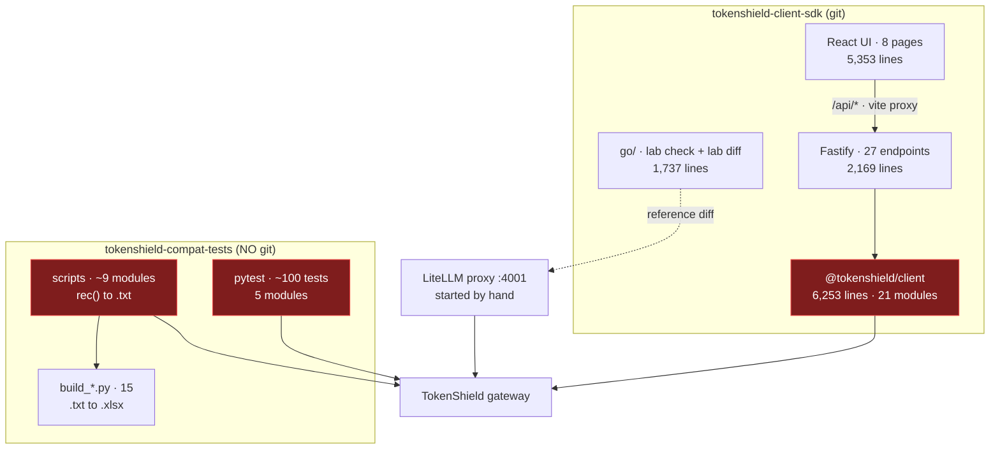
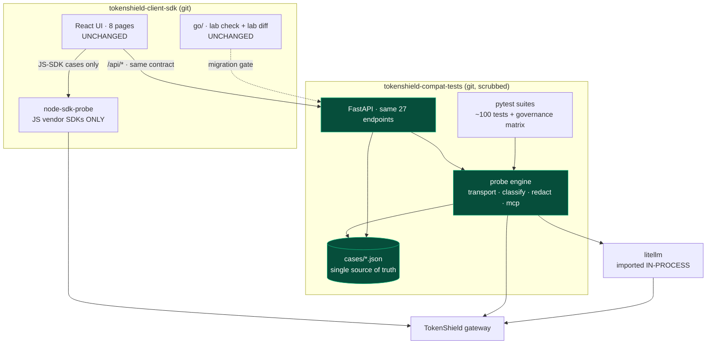
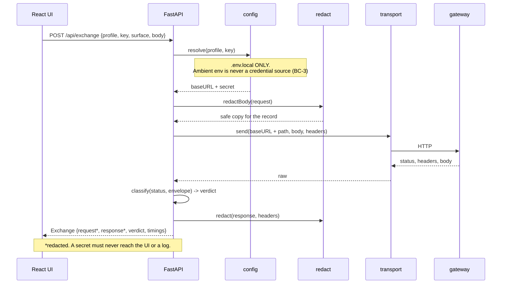
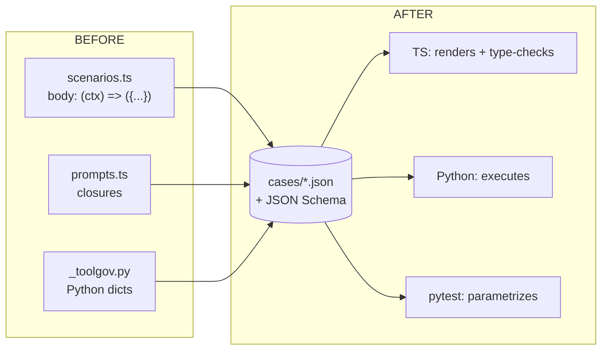
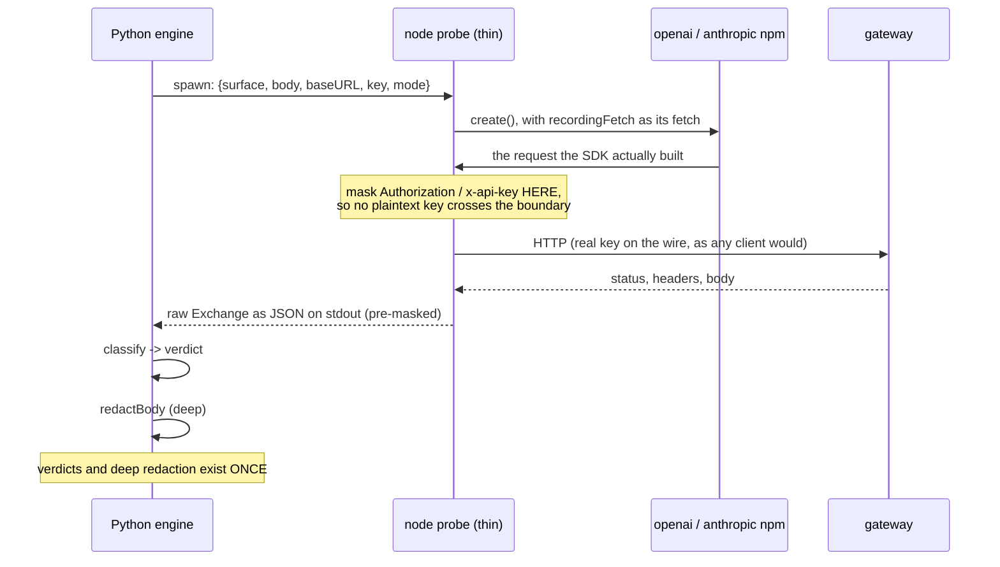

# Convergence — Python probing + TS UI

**Status:** **Phase 0.1 done** (2026-09-07). 0.2 is a user action — rotate **3 keys** (D-8).
0.3 (`git init`) can run before or after 0.2; running it first makes the rotation a
reviewable diff, and the 0.1 gate re-runs before any commit either way.
**Decisions:** all closed as of 2026-09-07 (§10).
**Governs two repos:** `tokenshield-client-sdk` (this one) and
`tokenshield-compat-tests`.
**Maintained during execution.** Every phase updates §10 Decision log and §11
Change log. A phase is not done until this file reflects it.

---

## 1. Why

Two independent efforts probe the same gateway today. Neither knows about the
other, and they have already re-derived each other's work — the MCP manual test
cases written in this repo duplicate `TOOL_GOVERNANCE_TEST_PLAN.md` Groups A–D
almost case for case.

The target is one probing engine in Python, one UI in TypeScript, one findings
ledger. Python is chosen because it is where the customer reality is: the
`openai` Python SDK is the reference client, and **LiteLLM is itself a Python
library**, so the reference comparison becomes an in-process import instead of a
proxy on `:4001` with provider credentials that have to be guessed at.

### What makes this different from the abandoned Go migration (AD-32)

The shape is identical — rewrite a working layer in another language — so the
distinction has to be explicit or the mistake repeats.

| | Go migration | This |
|---|---|---|
| New capability | none | reference SDK, LiteLLM in-process, distributable pytest suite |
| Layer count | 1 → 2 (added a duplicate) | 2 → 1 (absorbs an existing duplicate) |
| Customer-visible change | none in ~6 sessions | a suite a customer can run against their own key |
| Duplication policing | 1,100 lines of golden files | temporary, and gated by `lab diff` |

**The second row is the whole argument.** It only holds if we converge *and
retire*. Adding a Python backend while keeping both existing probing layers
produces three, which is worse than today. §9 carries the tripwire.

---

## 2. Ground truth — what actually exists

Measured 2026-09-07, not recalled.

### 2.1 `tokenshield-client-sdk` (this repo)

| Part | Lines | Contents |
|---|---|---|
| `packages/client` | 6,253 | 21 modules — transport, classify, scenarios, prompts, mcp, fields, probes, surfaces, tools, governance, preflight, redact, stream, sse, adapters, management, signal, curl, types, index |
| `packages/server` | 2,169 | Fastify, **27 endpoints**, 127.0.0.1 only |
| `packages/web` | 5,353 | React 19 + Vite 6 + Tailwind 4, **8 pages** |
| `go` | 1,737 | `lab check` (gateway source-drift), `lab diff` (two-gateway differ) |

Verified working 2026-09-07: all 8 pages render, no console errors, all six
preflight checks pass against Prod US. 19 findings recorded in `FINDINGS.md`.

Only ~1,000 of the 6,253 client lines are baseURL calling (`transport` 616,
`client` 211, `sse` 124, `signal` 67). The rest is domain logic.

### 2.2 `tokenshield-compat-tests`

10,860 lines of Python. **Not a git repository.** `requirements.txt` declares
`openai>=1.40`, `pytest>=8.0`, `requests>=2.31`, `pymongo>=4.6`.

Three distinct kinds of thing live here:

| Kind | Modules | Detail |
|---|---|---|
| **pytest suites** | 5 | ~100 test functions: `test_chat_completions.py` (33, 9 xfail), `test_keys.py` (25, 10 spend), `test_tool_calling.py` (21, 4 xfail), `responses_sdk_test.py` (13), `responses_toolgov_test.py` (8) |
| **standalone scripts** | ~9 | `main()` + `rec(cid, title, verdict, detail)` → `.txt`. `chat_params_test.py`, `responses_test.py`, `sr_test.py`, `management_keys_test.py`, `test_tool_breaking.py`, others. **Not collected by pytest despite the name.** |
| **report builders** | 15 | `build_*.py` read the `.txt` and emit `.xlsx` |

Plus design docs that are ahead of anything in this repo:
`TOOL_GOVERNANCE_TEST_PLAN.md` (12-key matrix, Groups A–D),
`TOOL_GOVERNANCE_REGRESSION_DESIGN.md`, `MANAGEMENT_API_SPEC.md`,
`RUNBOOK.md`, `colgate-poc/TEST_MATRIX.md`.

### 2.3 Coverage overlap

| Surface | TS lab | Python |
|---|---|---|
| `/v1/chat/completions` | yes | yes (3 modules) |
| `/v1/responses` | yes | yes (3 modules) |
| MCP servers / tools / policy | yes + **UI + wire-name derivation** | yes + **12-key governance matrix** |
| `/v1/models` | yes (preflight) | **no suite** |
| `/v1/moderations` | yes (LANDMINE-1) | **no suite** |
| `/v1/embeddings` | no | yes |
| `/v1/files` | no | yes |
| Smart routing | no | yes |
| Management API | partial (mint) | yes + spec + Mongo seeding |
| Streaming analysis (gaps, timings) | **yes, unique** | partial |
| LiteLLM reference diff | **yes, unique** | no |
| `/v1/messages` (Claude Code) | no | no — manual plan only |
| `/v1/completions`, `/v1/batches`, token counting | no | no |

Neither side is a superset. Both have unique value.

### 2.4 Things Python already does better

Recorded because each is a gap in this repo that convergence closes for free:

- **`strict=True` xfail.** A landmine that gets fixed becomes XPASS and *fails
  the build*. This repo hit exactly the opposite failure on 2026-09-06: a
  status-only expectation would have gone green while the defect persisted.
- **Custom request headers.** `headers(api_key, extra=...)` already supports
  `x-mcp-servers`, which is the entire test group this repo lists as blocked.
- **Spend gating** via `TS_ALLOW_SPEND=1` and a `spend` marker, rather than
  ad-hoc judgement per run.
- **Mongo key seeding** (`seed_key.py`) using the gateway's own SHA-256 hashing,
  so scoped fixture keys exist without the Java control plane.
- **Shared vocabulary already.** LANDMINE-3 means the same thing in both repos,
  and the Python side cites gateway source (`provider.go:67`).

### 2.5 Blocking problems found during the check

| ID | Problem | Severity |
|---|---|---|
| **BC-1** | **23 distinct credentials, not 8.** *Corrected 2026-09-07 during Phase 0.1 — the original figure came from a grep scoped to `.py`/`.txt`/`.csv` only, and a tree-wide scan found nearly three times as many.* Actual spread: **15 in `RUNBOOK.md`** (a committed doc), 10 across five `env.*` scripts (the intended credential store), 2 `cg-mk-` **management keys** in `build_management_keys_xlsx.py`, one shared production key duplicated across 6 modules as `DEV_KEY`, and one inside a generated `.xlsx`. | **critical** |
| **BC-2** | That repo has **no git**. `git init` before scrubbing bakes BC-1 into history permanently. | **critical, sequencing** |
| **BC-3** | Credential policy conflict. Python reads `os.environ` for keys. This repo reads `.env.local` and **deliberately never** the ambient environment. Both cannot be right. | high |
| **BC-4** | `TS_KEY` silently **shadows** `TOKENSHIELD_API_KEY` in `chat_params_test.py`. Documented in RUNBOOK §5; already cost 2 hours of 403 debugging once. | high |
| **BC-5** | Base URL convention conflict. Python `TOKENSHIELD_BASE_URL` **includes** `/v1`; this repo's profiles exclude it. | medium |
| **BC-6** | `pymongo` gives the Python side direct Mongo access. The standing constraint is that the SDK stores nothing in a database. Reading and seeding fixtures is not storing, but the boundary must be written down. | medium |
| **BC-7** | Two default model matrices: Python defaults to GLM, this repo to `bedrock-claude-haiku-4.5`. | low |
| **BC-8** | `TOOL_OUT` / `CHAT_OUT` are **truncated every run**, so a run silently destroys the previous evidence. | low |

---

## 3. Current architecture (HLD)

Red boxes all probe the same gateway. That is the duplication.

---

## 4. Target architecture (HLD)

Three things to notice:

1. **The UI's contract does not change.** Same 27 endpoints, same shapes. The UI
   is not part of this migration.
2. **Node keeps exactly one job** — running the JS vendor SDKs (`openai`,
   `@anthropic-ai/sdk`). That is coverage, not duplication: customers use both
   the JS and Python SDKs, so both are real signals.
3. **LiteLLM is imported, not proxied.** No `:4001`, no provider-credential
   ambiguity of the kind that made two cases uncomparable on 2026-09-06.

---

## 5. Component ownership — moves, stays, dies

| Component | Lines | Fate | Why |
|---|---|---|---|
| `transport.ts` | 616 | **moves** | the baseURL layer; Python has it partly in `_util.py`. Not kept for the probe — see D-7 |
| `sse.ts` | 124 | **moves** | Python `parse_responses_sse` already exists |
| `classify.ts` | 193 | **moves** | verdict logic belongs with the engine |
| `redact.ts` | 195 | **moves — Python owns it outright** | see D-7: the probe emits pre-masked records, so deep redaction exists once |
| `mcp.ts` | 766 | **moves**, merge with `_toolgov.py` | biggest single merge; wire-name derivation is unique to this repo and must survive |
| `scenarios.ts` | 646 | **becomes data** (Phase 1) | closures cannot cross languages |
| `prompts.ts` | 692 | **becomes data** (Phase 1) | same |
| `fields.ts` | 272 | **becomes data** | already a table transcribed from LiteLLM source |
| `probes.ts`, `surfaces.ts`, `governance.ts`, `preflight.ts`, `tools.ts`, `management.ts`, `signal.ts`, `stream.ts` | 1,796 | **moves** | engine logic |
| `adapters.ts` | 312 | **stays in Node** | imports the real `openai` / `@anthropic-ai/sdk` npm packages. No Python path to the JS SDKs. |
| *(new)* `probe.ts` | ~150 | **new, replaces transport for the probe** | D-7: HTTP + header masking + raw JSON on stdout. Python classifies and redacts. |
| `types.ts` | 244 | **splits** | wire types generated from a shared schema; UI view types stay TS |
| `curl.ts` | 43 | **moves** | trivial |
| `packages/web` | 5,353 | **stays, untouched** | |
| `go/` | 1,737 | **stays, untouched** | `lab diff` is the migration gate |
| Python `build_*.py` (15) | — | **stays**, later fed by the engine | xlsx reporting is a real deliverable |
| Python scripts (~9) | — | **converge** into the engine + pytest | they duplicate what `/api/scenarios/run` does |

---

## 6. LLD — request path

What one probe looks like after convergence. The `Exchange` record is the
contract between engine and UI and must survive the move byte-compatible, or the
UI's exchange log breaks.

## 6.1 LLD — credential resolution (resolves BC-3, BC-4)

The single most dangerous divergence between the two repos. This is the rule the
merged engine must implement.

**Resolved: D-2 option C — the alias-slot model.** The danger was never the
environment; it was the *unnamed default*. `TOKENSHIELD_API_KEY` is a default:
picked up implicitly, unattributable, single-valued, and the only reason `TS_KEY`
can shadow anything at all. Shadowing is possible only between two variables that
both mean "the default key". `TS_KEY_MCP_SELECTED` is a named slot and has none of
those properties — and the governance matrix already works that way.

A flag was the wrong control. A flag everyone sets is not a control, and in CI it
would be permanently on.

Why this satisfies both consumption models:

| Property | Needed by | Satisfied because |
|---|---|---|
| attributable — a finding names its key | this repo | the alias is on the `Exchange`, not "whatever was exported" |
| many keys at once | this repo, and the 12-key matrix | one slot per alias, in either source |
| no silent prod run | both | there is no bare default to pick up |
| `pytest` idiom | Python suite | `TSLAB_KEY_FOO=... pytest` still works |
| CI secret injection | Python suite | CI sets slots as environment variables |
| the matrix keeps its shape | Python suite | it was already one variable per key |

**Rule:** no bare default at any level. An unnamed key request errors rather than
guessing. `TOKENSHIELD_API_KEY` and `TS_KEY` are deleted, which fixes BC-4
structurally rather than removing one variable and leaving the pattern in place.

## 6.2 LLD — cases as data (Phase 1)

Bodies become JSON with a small template vocabulary (`{{model}}`,
`{{embedModel}}`) instead of arbitrary closures. Anything that genuinely needs
code becomes a named generator both sides implement — kept to as few as
possible, and every one listed in §11 when added.

## 6.3 LLD — the JS-SDK probe boundary (D-7)

Tracing what `adapters.ts` actually needs changed this design. `recordingFetch`
is handed to the SDK's constructor and delegates to `Transport.sendRaw`, so
keeping the probe on the existing stack drags in **1,439 lines** — transport,
classify, redact, signal, sse, types — every one of which Python would also own.
Parallel implementations policed by golden files is precisely the Go mistake, and
1,400 lines of exactly that were deleted on 2026-09-07 (AD-32).

So the boundary moves instead: the probe does HTTP and nothing else.

What the probe keeps: `adapters.ts` (312) plus a new `probe.ts` (~150) plus the
wire types. What it does **not** keep: classify, redact, signal, sse, transport.
Duplication is a ~20-line header mask, not 1,439 lines of parallel logic.

The header mask is the one thing that exists on both sides, and it is tiny,
single-purpose, and covered by the same test vectors as the Python masker.

**Residual risk:** the raw record crosses a pipe. It is pre-masked, same machine,
same trust boundary as the process holding the key anyway — but it is a new path
and Phase 2 must include a test asserting no `cg-ak-` / `cg-mk-` value can appear
on that boundary.

---

## 7. Conventions to reconcile before any code moves

| # | Conflict | Resolution |
|---|---|---|
| 1 | baseURL includes `/v1` (Python) vs excludes it (TS) — BC-5 | **excludes.** Profiles name a gateway, not a surface; `/v1/...` is part of the path. Python's `BASE_URL` gets a one-line shim. |
| 2 | Credential source — BC-3, BC-4 | **resolved, D-2 option C**: alias slots in either `.env.local` or the environment, no bare default, `TOKENSHIELD_API_KEY` and `TS_KEY` deleted. §6.1 |
| 3 | Default model matrix — BC-7 | one default per repo is fine; the **case files** must never hardcode a model. `{{model}}` only. |
| 4 | Findings numbering | one ledger: `FINDINGS.md` here. Python landmine numbers are authoritative where they exist (LANDMINE-1/2/3), since they cite gateway source. |
| 5 | Result artefacts truncated per run — BC-8 | timestamped output directory; never truncate. |
| 6 | Mongo access — BC-6 | allowed for **reading** org/key config and **seeding fixture keys** only. The lab still persists no state of its own. Written into the engine's module docstring. |
| 7 | Redaction ownership | **resolved, D-7**: Python owns deep redaction; the Node probe masks auth headers before emitting. One deep implementation, one ~20-line mask. §6.3 |

---

## 8. Phases

Each phase has an exit gate. A phase is not done until its gate passes **and**
§10/§11 of this file are updated.

### Phase 0 — Safety and ground truth *(no migration work)*

Ordered. 0.1 must precede 0.3.

| Step | Action | Gate |
|---|---|---|
| 0.1 | ~~Scrub the 8 real credentials from 12 files~~ Scrub every credential from files that will be committed (BC-1, corrected to 23). Source reads named env slots via a new `_creds.py`; `RUNBOOK.md` keeps a name-only inventory; the `env.*` credential store is gitignored rather than scrubbed, because it is the store. | **restated:** no credential in any file **git would track**. A tree-wide grep returning nothing was the wrong gate — the `env.*` scripts legitimately hold keys and `env.toolgov.sh` says so in its own header; destroying them would break a working setup. | **DONE 2026-09-07** |
| 0.2 | **User action, narrowed to 3 keys** (see D-8 for why the other 20 are an accepted risk): the **2 `cg-mk-` management keys** from `build_management_keys_xlsx.py`, and **`Bedrock Test`** — the `cg-ak-` key its own source comment called a prod key, duplicated as `DEV_KEY` across six modules. **Order matters:** mint replacements *first*, revoke the old management keys *last*, or you lose the minting path. | user confirms the 3 |
| 0.3 | `git init` + first commit. *(`.gitignore` moved into 0.1 — the 0.1 gate depends on it, since "no credential in a tracked file" is only true once the credential store is excluded.)* | history contains no credential |
| 0.4 | Merge the two findings ledgers into `FINDINGS.md`; dedupe against Python landmines; mark every entry with its source repo | one ledger, no contradictions |
| 0.5 | Write §7 conventions into both repos as code comments, not just here | both sides agree on baseURL and credential rules |

**Deliverable a person can see:** one findings list, and a version-controlled
Python repo with no secrets in it.

#### Exposure assessment (measured 2026-09-07, after 0.1)

Written down because the first framing of 0.2 — "rotate all of them" — was not
proportionate, and the reasoning for narrowing it should outlive the decision.

| Question | Answer |
|---|---|
| Cloud-synced? | **No.** OneDrive exists at `C:\Users\shiva\OneDrive`; the repo is a sibling of it, not inside it. Nothing left the machine. |
| Ever committed or pushed? | **No.** There was no git, which is BC-2 — and the reason BC-2 was rated critical. |
| Who could read the plaintext? | the machine's own user, anything running as them in that directory, and local backups if any exist |
| What was the real risk? | **prospective, not realised**: one `git init && git push` from publishing 23 working keys. Phase 0.1 closed exactly that. |

So the exposure was local disk on a single-user, unsynced machine. That justifies
rotating the keys whose blast radius is large, and not the scoped test keys.

#### How rotation works on this gateway

Creation is in the Management API; revocation is not, and is control-plane only.
Both facts come from the compat suite's own docs and test plans.

| Action | Mechanism | Source |
|---|---|---|
| Mint an API key | `POST {base}/api/v1/management/api-keys` with `x-management-key` | `MANAGEMENT_API_SPEC.md` §4 |
| Revoke an API key | admin console: ban icon → type `REVOKE` → confirm | test case A9, `build_test_plan_xlsx.py` |
| Revoke a management key | GraphQL `revokeAiGatewayManagementKey(managementKeyId:)`, org-guarded | test case B5, same file |

### Phase 1 — Cases as data

| Step | Action | Gate |
|---|---|---|
| 1.1 | Design `cases/*.json` + JSON Schema; template vocabulary only | schema validates |
| 1.2 | Port `scenarios.ts` (646) and `prompts.ts` (692) to case files; TS reads the files instead of closures | **all 26 TS test files still pass; UI renders the same suites** |
| 1.3 | Python reads the same files | a case file executed both sides produces the same request body |

**Gate:** `lab diff` shows `/api/scenarios/suites` and `/api/prompts/cases`
identical before and after. Standalone value: even if we stop here, cases are
language-neutral.

### Phase 2 — Python engine skeleton

| Step | Action | Gate |
|---|---|---|
| 2.1 | FastAPI on a second port; `config` (§6.1 alias slots), `redact` (the only deep impl), `transport`, `Exchange` | unit tests, including the redaction leak tests ported from `redact.test.ts`, **plus a probe-boundary test asserting no key value can cross it** (§6.3) |
| 2.2 | `/api/health`, `/api/config` only | `lab diff -a node -b python` → 0 differences |

### Phase 3 — Read-only endpoints

`/api/preflight`, `/api/models`, `/api/runs`, `/api/runs/:id`,
`/api/prompts/cases`, `/api/scenarios/suites`, `/api/mcp/browse`.
**Gate:** `lab diff` clean on all seven; UI switched over by changing one port.

### Phase 4 — The exchange path

`/api/exchange`, `/api/compare`, `/api/mcp/test`, `/api/mcp/call`,
`/api/mcp/aggregate`, `/api/tools/loop`.
**Gate:** `lab diff` clean; spend-incurring cases run once, by hand, with the
cost stated first.

### Phase 5 — Streaming

`/api/stream`, `/api/prompts/run`, `/api/scenarios/run`,
`/api/governance/burst`. The hardest phase: SSE relay, partial UTF-8 across
chunk boundaries, gap/timing analysis.
**Gate:** byte-identical SSE frame sequence for a recorded fixture, plus
`lab diff` on the terminal payload.

### Phase 6 — Stateful and management

`/api/targets/*`, `/api/keys/mint`, `/api/scenarios/export`,
`/api/governance/probe-models`. Uses `MANAGEMENT_API_SPEC.md`.
**Gate:** `lab diff` clean; `DELETE` paths tested against a disposable key.

### Phase 7 — Absorb the compat suite

| Step | Action | Gate |
|---|---|---|
| 7.1 | The ~9 standalone scripts become engine calls + pytest parametrization | same verdicts as the last recorded `.txt` run |
| 7.2 | `build_*.py` read engine output instead of scraped `.txt` | xlsx byte-comparable on the same input |
| 7.3 | LiteLLM in-process; retire the `:4001` proxy and `reference/litellm/config.yaml` | reference cases reproduce `docs/REFERENCE_COMPARISON.md` |

### Phase 8 — Retire the Node backend

| Step | Action | Gate |
|---|---|---|
| 8.1 | Reduce `packages/server` to the JS-SDK probe only | UI green on Python for all 27 endpoints |
| 8.2 | Delete what the JS-SDK probe does not need from `packages/client`. Under D-3 and D-7 the probe keeps `adapters.ts` (312) + a new `probe.ts` (~150) + wire types (~80), so roughly **5,700 of 6,253 lines are deleted rather than maintained** | typecheck, tests, eslint clean |
| 8.3 | One `README` covering both repos and the split | a new person can run it from the README alone |

**Do not start Phase 8 until Phases 3–6 have been green for a full working
session.** Retiring the fallback is the irreversible step.

---

## 9. Risks and the tripwire

| Risk | Mitigation |
|---|---|
| **Three layers instead of one** — the Go mistake, repeated | Phase 8 is mandatory, not optional. If we will not commit to Phase 8, do not start Phase 2. |
| Redaction regresses during the move | Phase 2.1 ports the redaction tests *first*. A leak here is worse than any gateway finding. |
| A plaintext key crosses the new probe boundary (D-7) | the probe masks auth headers before emitting; Phase 2.1 gate includes a test that no `cg-ak-`/`cg-mk-` value can appear on stdout |
| Big-bang cutover fails | every endpoint gated by `lab diff`; Node stays until Phase 8 |
| Python environment friction | already seen: 3.14.3 against LiteLLM's `<3.15`, and a cp1252 crash on its banner. **Pin a 3.12 venv in Phase 0.** |
| Weaker typing than TS strict | pyright strict in CI from Phase 2.1; wire types generated from the shared schema |
| Gateway moves under us | it already does — 2 of 3 re-checked findings had changed within 4 days. Phase 0.4 marks staleness per finding. |
| This blocks the P0 findings | it must not. The three P0s in `FINDINGS.md` are actionable now, by the gateway team, independent of every phase here. |

**Tripwire.** If two consecutive working sessions produce no new capability and
no change a person can see, stop and re-read §1. That is the signal missed
during the Go migration — every individual step there looked reasonable.

**Estimate.** Revised down to **7–11 sessions** now that D-3 and D-7 are
settled: Phase 0 (1), 1 (1–2), 2 (1–2), 3–6 (3–5), 7 (2–3), 8 (**under 1** — it
is mostly deletion, not porting, since the probe keeps ~540 lines rather than
1,751 and nothing is published for outside consumption).

If that is still too long, keeping the two repos separate with clear jobs is a
legitimate answer and this plan should be declined rather than half-executed.

---

## 10. Decision log

Maintained during execution. Every entry: what was decided, why, and what it
rules out.

| ID | Decision | Status |
|---|---|---|
| D-1 | Converge on Python probing + TS UI, rather than porting the backend to Go | **accepted** by user 2026-09-07 |
| D-2 | **Option C — the alias-slot model.** Credentials resolve by named alias from an explicit argument, then `.env.local`, then a `TSLAB_KEY_<ALIAS>` environment slot, then fail. No bare default anywhere; `TOKENSHIELD_API_KEY` and `TS_KEY` deleted as concepts. Rules out the flag-gated compromise, which would have been permanently on in CI and therefore not a control. §6.1 | **accepted** 2026-09-07 |
| D-3 | **The pytest suite is the customer-facing artefact; `packages/client` stays private.** Three audiences exist — the gateway team wants `FINDINGS.md`, an evaluator wants the xlsx/PDF report (already being produced, see `colgate-poc/`), an integrating customer wants a suite they run against their own key. Only the third needs published code, and Python serves it better. Rules out committing to a public npm API surface and semver. | **accepted** 2026-09-07 |
| D-4 | baseURL excludes `/v1`; profiles name a gateway, not a surface | **accepted** 2026-09-07, §7.1 |
| D-5 | Mongo is read/seed only; the lab persists nothing of its own | **accepted** 2026-09-07, §7.6 |
| D-6 | Node retains the JS vendor SDK probe permanently — it is coverage, not duplication, because customers use both the JS and Python SDKs | **accepted** 2026-09-07, §4 |
| D-8 | **Rotate 3 of the 23 exposed keys; accept the risk on the other 20.** The 2 management keys mint others, so their blast radius is the whole org; `Bedrock Test` was called a prod key by its own source comment and was the most widely duplicated. The remaining 20 are scoped test keys on $1–2/month budgets, several deliberately restricted for the governance matrix, and the exposure was local disk on an unsynced single-user machine that was never pushed. Rules out treating 0.2 as a 23-key task that would block Phase 0 for little gain. **Reverses my own earlier statement that rotation was "the only way to close" the exposure** — true in principle, not proportionate here. | **accepted** 2026-09-07 |
| D-7 | **The probe becomes a thin CLI rather than keeping the TS stack.** Tracing `adapters.ts` showed it pulls in 1,439 lines (transport, classify, redact, signal, sse, types) that Python would also own. This reverses the lean toward "accept the duplication, police it with a golden corpus" — that is the Go mistake restated, and 1,400 lines of it were deleted the same day (AD-32). The probe now does HTTP plus a ~20-line auth-header mask; Python owns verdicts and deep redaction. §6.3 | **accepted** 2026-09-07 |

## 11. Change log

Appended as phases execute. Empty until Phase 0 begins.

| Date | Phase | Change | Files |
|---|---|---|---|
| 2026-09-07 | — | This plan written. Background check completed against both repos; BC-1..BC-8 recorded. No code changed. | `docs/CONVERGENCE.md` (new) |
| 2026-09-07 | **0.2** | Scope narrowed from 23 keys to 3 (**D-8**) after measuring the exposure rather than assuming it: the repo is not inside OneDrive and was never committed, so nothing left the machine and the risk was prospective — which Phase 0.1 already closed. Recorded the exposure assessment and the mint/revoke mechanics (Management API creates; the console and a GraphQL mutation revoke) so the reasoning survives the decision. Still a user action; not done. | `docs/CONVERGENCE.md` |
| 2026-09-07 | **0.1** | **Credential scrub complete; gate passed.** Backed the un-versioned repo up first. New `_creds.py` resolves by named env slot and fails loudly with no built-in default — replacing one production key that was duplicated as `DEV_KEY` across 6 modules, three of them under a comment reading *"do not commit"*. `build_management_keys_xlsx.py`: 4 keys (2 management) became stable labels so the report keeps its meaning. 5 result `.txt` files masked. `RUNBOOK.md`: 15 key values replaced by a name-only inventory. `.gitignore` added covering the `env.*` credential store, generated `.xlsx`, and run artefacts. **BC-1 corrected 8 → 23** and the 0.1 gate restated. Verified: 40 files compile, 167 tests collect, a missing credential exits with guidance naming the variable, and no credential remains in any of the 58 files git would track. | `tokenshield-compat-tests/*` (10 files), `docs/CONVERGENCE.md` |
| 2026-09-07 | — | D-2 and D-3 resolved; D-4/5/6 confirmed; **D-7 added** after tracing the probe's real dependency closure. §5 ownership corrected, §6.1 credential LLD replaced with the alias-slot rule, §6.3 probe-boundary LLD added, §7 rows resolved, Phase 2.1 and 8.2 gates tightened, estimate revised 8–13 → 7–11 sessions. Still no code changed. | `docs/CONVERGENCE.md` |
